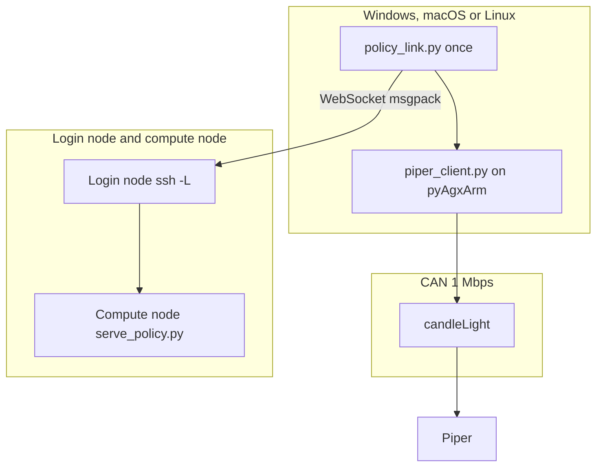

# Developer guide: Piper client and policy link

This guide is for people changing the code or checking the protocol. Operating steps are in `USER_GUIDE.md`. The Chinese version is `开发文档.md`.



## Find a topic

| You want to change or look up | Section |
| --- | --- |
| Read-only state and gripper motion | [piper_client.py](#piper_clientpy) |
| CAN backend per platform, firmware profile | [Official SDK (pyAgxArm)](#official-sdk-pyagxarm) |
| Fields sent to the model | [Observation contract](#observation-contract) |
| How a returned chunk becomes pose commands | [Action contract](#action-contract) |
| WebSocket and timeouts | [Policy link](#policy-link) |
| The device will not open | [Device ownership](#device-ownership) |
| CAN frame layout and IDs | [Protocol](#protocol) |
| Libraries already shown not to work | [Do not switch to these entry points](#do-not-switch-to-these-entry-points) |
| Work that is not done | [Boundary](#boundary) |
| A candidate policy repository arrives | [Check a candidate repository](#check-a-candidate-repository) |

## Which files to use

| File | Role |
| --- | --- |
| `piper_client.py` | `PiperClient`: a thin layer on the official `pyAgxArm` SDK in degrees and millimetres. `read_state()`, `driver_faults()`, gripper, leave teach, enable, MOVE J, MOVE P. See [piper_client.py](#piper_clientpy) |
| `piper_can_bus.py` | Picks the CAN backend for this platform and the firmware profile, and drives the adapter over USB on Windows and macOS. See [Official SDK (pyAgxArm)](#official-sdk-pyagxarm) |
| `policy_link.py` | Builds the observation, keeps one WebSocket open, and loops inference. The camera and CAN writes are not in the same process |
| `policy_step.py` | Integrates one action chunk into an end-effector trajectory in the base frame and writes it to CAN |
| `team_config.json` | Login account, SSH alias, checkpoint, and log directory. Copy it from the tracked blank `team_config.example.json`; the real file is gitignored because the repository is public |
| `team_config.py` | `run` submits the job, waits until it listens, opens one local forward, and starts continuous control. `once` starts another round while the forward is up. `down` cancels the job and closes the forward. `job` and `serve` still only print commands |
| `simple_policy_server.py` | Scripted policy server for testing the link without a model. See [macOS and the simple server](#macos-and-the-simple-server) |
| `USER_GUIDE.md` | Operating steps |
| `用户文档.md` | Operating steps in Chinese |
| `_can_listen.py` | Capture that receives only and transmits nothing. The log is `_can_listen_log.txt` in this directory |
| `check_candidate_repo.py` | After a candidate policy repository arrives, search its config, actions, normalization, cameras, and any Piper execution code |
| `prepare_dataset.py` | Pack successful demonstrations into `datasets/piper_finetune`. Server changes are in `SERVER_TRAINING.md` |

Paths are relative to the directory that contains this code. Do not put someone's desktop absolute path into the docs or into new code. Server paths come from `team_config.json`.

All CAN traffic goes through AgileX's `pyAgxArm`. The older `piper_sdk` and `piper_ros` are not used and not in this repository.

## Official SDK (pyAgxArm)

`pyAgxArm` is AgileX's current Python SDK for Piper and Nero. It opens the bus with only `can.interface.Bus(interface=..., channel=..., bitrate=...)` from `python-can`. Its own routes for this adapter:

| Platform | pyAgxArm's route | With this candleLight (gs_usb, `1D50:606F`) |
| --- | --- | --- |
| Linux | `socketcan`, `can0` | Works |
| Windows | `agx_cando` (`cando.dll`) | The DLL does not contain this adapter's WinUSB GUID; probably for another AgileX module. Not tested |
| macOS | `slcan`, `/dev/ttyACM0` | Does not work: this adapter has no serial port |

`piper_can_bus.py` fills the gap. It registers a `python-can` interface named `piper_usb` that drives the adapter directly over USB (WinUSB through ctypes on Windows, libusb through pyusb on macOS) and converts `can.Message` to and from the 20-byte gs_usb frame. Transmit echoes are dropped. The pyAgxArm code is not changed.

```python
from piper_can_bus import create_piper_arm
robot = create_piper_arm()   # Linux with can0: socketcan; otherwise piper_usb
robot.connect()
```

- `can_args()` picks the interface and channel: `socketcan` / `can0` when `/sys/class/net/can0` exists (`PIPER_CAN_INTERFACE` names another interface), otherwise `piper_usb`.
- On Linux, `bring_up_can()` sets the interface to 1 Mbps and up when it is down (after a replug). That needs root.
- `create_piper_arm()` asks the arm for its firmware version (a query, no motion) and picks the driver profile through `resolve_firmware_profile()`; pass `firmware=` to skip it. It waits until feedback is arriving first, because `get_firmware()` drops replies before the feedback rate is measured.
- `open_bus()` returns a plain `python-can` bus on the same adapter, for `_can_listen.py`.

pyAgxArm keeps a background thread that parses every feedback frame, so reads return the latest values at once. It reports radians and metres; `PiperClient` converts to degrees and millimetres.

Never call `calibrate_gripper()` or `calibrate_joint()`: they send `0xAE` and write the current position as the zero point.

What was checked:

- IQ9075 (Linux, socketcan): `read_state()`, `driver_faults()`, `gripper_max_mm()`, `team_config.py arm` and `_can_listen.py` (58,026 frames in 25 s, about 200 Hz per high-speed ID). pyAgxArm `enable()`, `set_speed_percent(20)` and `move_j` turned J1 by +10° and back with no driver fault. Firmware `S-V1.9-0` resolves to profile `v189`.
- macOS with the real adapter: pyAgxArm over `piper_usb` reads the same joints, flange pose and firmware as on IQ9075, at about 200 Hz feedback.
- Offline with a fake adapter: `PiperClient` sends leave-teach `0x150` byte 2 `0x02`, enable `0x471`, MOVE J through `0x151`, interpolated `0x155`–`0x157`, and gripper `0x159` with the set-zero byte `0x00`.
- Not yet run: `ready`/`home` and a policy chunk through the new `PiperClient`, and `piper_usb` on a real Windows adapter.

Install: `pip install python-can "git+https://github.com/agilexrobotics/pyAgxArm.git"`, plus `pyusb` and `brew install libusb` on macOS. On IQ9075 (no pip), unpack the `python-can`, `packaging`, `typing_extensions`, `wrapt` (aarch64) and `pyAgxArm` wheels into `.pylib`. That Python has no `sqlite3`, which `python-can` imports for a log writer this project does not use; a stub `sqlite3.py` in `.pylib` is enough.

## piper_client.py

`PiperClient` is a context manager. `connect()` calls `create_piper_arm()`, starts pyAgxArm's threads, and initialises the AgileX gripper effector. `close()` stops them and releases the adapter; it does not disable the arm, so the arm keeps holding its pose.

`read_state(timeout=0.6)` returns the latest feedback, waiting up to `timeout` for it to arrive after connect. Feedback older than 0.5 s counts as missing. `complete` is True only when every field below is present:

| Field | Source | Unit |
| --- | --- | --- |
| `joints_deg` | `get_joint_angles()` (`0x2A5`–`0x2A7`) | degrees |
| `gripper_mm` | gripper `get_gripper_status()` (`0x2A8`) | millimeters |
| `gripper_effort` | same, force | 0.001 N·m |
| `gripper_status` | same, status byte | raw value |
| `pose_mm_deg` | `get_flange_pose()` (`0x2A2`–`0x2A4`), `x y z rx ry rz` | millimeters and degrees |
| `status` | `get_arm_status()` (`0x2A1`) | see the protocol section |

Status names (`TEACHING`, `CAN_CTRL`, ...) come from the tables in `piper_client.py`, not from pyAgxArm, so recorded episodes and `dataset_export.py` keep the same strings.

`driver_faults()` reads `get_driver_states()` for the six joints and returns `{joint: [fault names]}`; a joint with no fresh feedback is reported as `no feedback`.

`gripper_max_mm()` asks the gripper for its configured stroke (`get_gripper_teaching_pendant_param()`). 70 or 100 is used; otherwise it falls back to 70. One arm answered 100.

`move_gripper(target_mm, effort=1000)` sends only the gripper command, repeated about every 10 ms until feedback is within 1 mm of the target or 4 seconds pass. The target is limited to 0–100 mm and the effort to 0–5000. It does not enable the joints, and the set-zero byte stays 0.

`exit_drag_teach()` sends pyAgxArm's `0x150` message with byte 2 = `0x02` (end drag-teach recording) five times. pyAgxArm has no public call for it, so this uses the driver's `_send_msg`. It is not an emergency stop and it does not write the zero point. `enable_arm()` calls `enable()`.

`move_joints(...)` checks the targets against `JOINT_LIMITS_DEG`, sets the speed with `set_speed_percent()`, and calls `move_j` every 5 ms for `duration`, with the target interpolated from `start_deg` and advanced `update_hz` times per second. `move_pose(...)` calls `move_p` every 10 ms for `duration`. Both can repeat one gripper command in the same loop.

While `0x2A1` control mode is `0x02` (`TEACHING`) and the teach byte is `0x01`, end-pose commands are not followed. Bit 6 of byte 6 in low-speed feedback `0x261`–`0x266` means that joint driver is enabled.

Putting the camera and CAN writes in one process exited with an access violation (`3221225477`) on Windows, so the arm lives in a separate process. `policy_link.MotionWorker` starts `policy_step.py worker` once per session; that process connects the arm once and answers state reads and chunks as pickled tuples on its stdin and stdout, printing to stderr. `policy_link.py` keeps only the camera, as a `LiveCamera` that stays open and whose thread keeps the newest frame. Before this, every cycle reopened the camera and reconnected the arm twice, with a firmware check each time, and held the last target for 0.5 s, which left a pause of 1–3 s between chunks; it is now tens of milliseconds plus inference.

## Policy link

`policy_link.py` uses the same WebSocket as `openpi_client`: after connect, the server sends one msgpack metadata message; each later observation is one msgpack message, and each reply is one msgpack message. NumPy arrays travel in an `__ndarray__` map whose keys are the bytes `data`, `dtype`, and `shape`.

Server directory, account, host name, and model name live only in each person's `team_config.json`. If a field is missing, `team_config.py` names the keys to fill and does not reuse someone else's paths. Operators run `python team_config.py run`. It submits or reuses a job named `serve-policy` on the login node, waits until the log contains `listening on`, reads `NodeAddr` from `scontrol`, opens one local `ssh -L` to that address, then calls `policy_link.py once`. On Windows the forward stays in its own window. On macOS it runs in the background, and `down` stops it with `pkill`. `down` cancels that user's `serve-policy` jobs and stops the matching local `ssh -N`. `job` and `serve` still only print text for someone who needs to start the server by hand.

Order inside `once`:

1. Retry the connection to `ws://host:port` up to 50 times, with a 2-second handshake timeout. `python team_config.py once` and `python policy_link.py once` without `--port` both use `local_forward_port`. `python policy_link.py serve` still listens on `127.0.0.1:8765` by default, which is the local placeholder server.
2. Receive metadata within 30 seconds and print `server_connected`.
3. Ask the motion worker for `read_state()`. If it is incomplete, raise and do not send.
4. `LiveCamera.read_bgr()` returns the first frame captured after the call from the Orbbec Astra Pro color camera (USB `VID_2BC5` `PID_0501`), and `model_image()` turns it into RGB padded to 224×224. Other cameras on the same computer are not selected. `build_observation(state, image)` sends it as `observation/image`.
5. Send the observation and print `image_mean` and `waiting_for_inference`.
6. Wait up to 600 seconds. If the reply is a string, raise it as a `RuntimeError`. That is how an OpenPI server returns an exception.
7. Print `actions_shape`. One verified return was `(50, 12)`. Then the motion worker executes the whole chunk and prints `pose_sent` plus the state read right afterward (no settle wait).
8. Return to step 3. `Ctrl+C` prints `stopped` and exits; the worker gets the same Ctrl+C and disconnects. The WebSocket, the camera, and the motion worker stay open for the whole loop. Only the worker opens the adapter.

`python policy_link.py serve` is a local placeholder on `127.0.0.1:8765`. It only checks the observation shape currently in this code and returns a placeholder action. It is not a substitute for anyone's checkpoint.

## Observation contract

Image count, state dimension, prompt, and action meaning all come from the loaded model. They are not a fixed standard of this repository. When the model changes, edit `build_observation()`, and point `policy_config` and `checkpoint_dir` in `team_config.json` at that checkpoint.

The table below is what the current function sends. It is not everyone's input:

| Key | Value |
| --- | --- |
| `observation/image` | uint8, `(224, 224, 3)`, Orbbec Astra Pro color frame, already RGB |
| `observation/joints_deg` | float32, `(6,)`. Scripted servers command joints with it; model servers drop it |
| `observation/state` | float32, shape `(16,)` |
| `prompt` | the `PROMPT` constant, currently `put the pen into the box`. It must match `meta/tasks.jsonl` character for character |

One image stream only. `pi05_piper_finetune` feeds it to `base_0_rgb` and sets `image_mask` false for both wrist slots, so do not copy this frame into `observation/wrist_image` or `observation/right_image`.

The order of these 16 numbers is written in `piper_train_state()`, bit-for-bit the same as `prepare_dataset.piper_train_state()` (a check script compared them and the difference was 0):

| Index | Content | How this client fills it |
| --- | --- | --- |
| 0–2 | end-effector position, meters, arm base frame | Piper `x y z` millimeters divided by 1000 |
| 3–6 | end-effector quaternion, **xyzw** | `rx ry rz` degrees to a matrix with `R = Rz(rz) Ry(ry) Rx(rx)`, then to a quaternion and reordered to xyzw |
| 7–12 | static base position and quaternion | exactly 0. Their `std` is 0, so `(x-mean)/(std+1e-6)` would amplify any offset a million times |
| 13 | base quaternion w | 1.0 |
| 14–15 | two finger joint positions, meters | opening in millimeters divided by 2000, opposite signs (22 mm is about `0.011, -0.011`) |

Do not change the msgpack packing. The frame must be RGB: `model_image()` already flips OpenCV's BGR and the server does not flip it back. This control loop does not use a camera extrinsic, and no hand-eye calibration was done.

## Action contract

`action_waypoints()` in `policy_step.py` interprets the current 12-value output as follows. This matches one end-effector delta policy that was checked. It is not a universal format for every checkpoint. When the model changes, replace this function. Do not write the 12 values to `0x155` as six joint angles.

| Index | Meaning | How this client uses it |
| --- | --- | --- |
| 0–2 | end-effector translation, base frame, controller units near [-1, 1] | Multiply by 0.05 m, then by 1000 for millimeters, and add to the current `x y z`. +X is forward, +Y is left, +Z is up |
| 3–5 | axis-angle, same base frame, controller units near [-1, 1] | Multiply by 0.5 rad and left-multiply onto the current orientation. Euler angles match `piper_fk`: `R = Rz(rz) Ry(ry) Rx(rx)` |
| 6 | gripper | At or above 0.5 means close, target 0 mm; otherwise open to `gripper_max_mm()` |
| 7–10 | base and torso | This Piper has no such mechanisms, so these values are dropped |
| 11 | control mode | Not a length; dropped |

`execute_steps` in `team_config.json` keeps only the first N steps of each chunk (empty means all of them). `ee_delta_scale` scales translation and rotation (empty means 1). Before any frame is sent, `check_limits()` refuses a chunk that reaches farther than `max_chunk_shift_mm` from the start pose. Each kept step is sent at 0.05 s with speed 50%. After the chunk, `policy_link.py` requests the next one with a new image and state. Verified: after leaving teach mode, the arm followed one chunk's final pose, with `motion=0`.

## macOS and the simple server

On Windows and macOS, `piper_can_bus.py` drives the candleLight over USB: `_WinUsbTransport` (ctypes, overlapped I/O) on Windows and `_LibUsbTransport` (pyusb, VID `1D50` / PID `606F`) on macOS. `open_transport()` sends the same gs_usb control transfers for both to start the bus at 1 Mbps for a 48 MHz clock. Close does not send the bus-stop control transfer, which hung the process.

The libusb transport drains the IN endpoint from a background thread into a 256-frame queue (about 0.1 s of feedback; the oldest frame is dropped when full). Without that, feedback at about 2,700 frames/s exhausts the adapter's frame buffers and OUT writes time out with errno 60 after about a dozen frames. This is why python-can's own `gs_usb` backend is not used. On Windows, reads and writes share one WinUSB handle and buffer, so `PiperUsbBus` serialises them with a lock.

Setup on a Mac:

```bash
brew install libusb
python3 -m venv .venv
.venv/bin/pip install numpy msgpack 'websockets>=13' opencv-python pyusb pyobjc-framework-AVFoundation pandas pyarrow python-can "git+https://github.com/agilexrobotics/pyAgxArm.git"
```

OpenCV on macOS numbers cameras in `uniqueID` order and cannot select one by USB ID. `_avfoundation_devices()` rebuilds that order through pyobjc, and the Astra Pro is the device whose model ID contains `VendorID_11205 ProductID_1281` (0x2BC5 / 0x0501). A non-empty `camera_index` in `team_config.json` overrides it. `python policy_link.py cameras` lists indexes with names. `python policy_link.py preview [--index N]` opens a live window with the 224×224 model input inset; q closes it. Camera access must be allowed for the app that runs the command.

`policy_step.check_limits()` runs before any frame is sent. A waypoint farther than `max_chunk_shift_mm` (default 30) from the pose read before the chunk, or outside the absolute base-frame box `workspace_mm` (`{"x": [min, max], ...}`; an empty axis is skipped), raises and sends nothing.

`simple_policy_server.py` returns a scripted `(50, 12)` chunk with the action meaning in `action_waypoints()`: +X by 10 mm and back, and the gripper alternating between chunks. With `server_mode` set to `"simple"`, `team_config.py setup-remote` copies it, `policy_link.py`, and `piper_client.py` to `remote_code_dir` and builds a venv there; `run` then submits it without a GPU. `"openpi"` keeps the `serve_policy.py` launch. Off Windows, the local forward is `ssh -f -N -L` in the background, and `down` stops it with `pkill`.

## Linux and IQ9075

Verified on a Qualcomm IQ9075 (aarch64 Yocto, Python 3.12) with the arm and the Astra Pro plugged in directly.

- CAN: the Linux kernel's gs_usb driver owns the adapter as `can0`, and pyAgxArm uses python-can's `socketcan` backend on it. `bring_up_can()` brings `can0` up at 1 Mbps after a replug; that needs root.
- Camera: `_v4l2_camera_index()` picks the `/dev/videoN` with USB IDs `2BC5:0501` and V4L2 index 0 (the capture node), opened with `CAP_V4L2`. A non-empty `camera_index` overrides it.
- Python there has no pip, `ensurepip`, `venv` or `sqlite3`. Download `manylinux` aarch64 cp312 wheels on another machine (`pip download --only-binary=:all: --platform manylinux2014_aarch64 --python-version 3.12 ...`), unzip them into `.pylib` in the code directory, and run with `PYTHONPATH=.pylib`. See [Official SDK (pyAgxArm)](#official-sdk-pyagxarm) for the `sqlite3` stub.

Driver faults: a joint driven into its mechanical stop trips overcurrent and disables that joint's driver; the controller then ignores every joint command while the gripper still works. `PiperClient.driver_faults()` reads byte 5 of `0x261`–`0x266`, and `policy_step.require_healthy_drivers()` refuses to send any motion frame while a fault is set. Power-cycle the arm to clear it.

`policy_link.py home` goes to `home_deg` from `team_config.json`, or `HOME_DEG` (J2 10°, J3 −5°), just above the folded rest pose. All zeros drove J2 into its stop on one arm and tripped that fault. Set `home_deg` per arm to the rest pose read on site, a little short of each stop.

## Joint-space actions

End-pose (MOVE P) targets from the folded rest pose are rejected by the arm's IK: status shows `TARGET_EXCEEDS_LIMIT` and only the gripper moves. A reply may therefore carry `"action_space": "joints"` with actions `(N, 7)`: six absolute joint angles in degrees and how far the gripper closes (0 fully open at `gripper_max_mm()`, 1 at 0 mm, values between partly closed). `policy_link.py` passes the action space to the motion worker; a reply without it is `ee_delta`.

`apply_joint_actions()` sends MOVE J (`0x151` byte 1 = `0x01`) and joints on `0x155` (J1, J2), `0x156` (J3, J4), `0x157` (J5, J6), big-endian int32 in 0.001 degrees, at 0.05 s per step, speed `joint_speed` (default 60%). Within each step `move_joints(start_deg=...)` interpolates from the previous target and resends about every 5–7 ms (about 140 Hz). MOVE J plans to each new target, so holding one target per 0.05 s step made J1 and J2 start and stop on every step; at 30% the arm also lagged the commanded rate. Before anything is sent, `check_joint_chunk()` refuses a step that moves any joint more than 3 degrees, or a chunk that moves a joint more than `max_chunk_joint_deg` (default 100) from the start. `move_joints()` refuses targets more than 2 degrees outside `JOINT_LIMITS_DEG` and clamps smaller excursions. The observation carries `observation/joints_deg` for scripted servers.

`simple_policy_server.py --mode demo` (the default) unfolds to `READY_DEG = [0, 45, -45, 0, 30, 0]` at half speed, then cycles a J1 wave (±30), a J5 nod with a J2/J3 reach, and a ±90 J6 twist with the gripper. Segment lengths scale so no joint exceeds 2.4 degrees per step. `--mode nudge` keeps the end-effector test.

In low-speed feedback `0x261`–`0x266`, the driver-enabled flag is bit 6 of byte 5 (0-based).

## Replay and server modes

Replay uses the drag-teach episodes from `episode_recorder.py` (see `数据采集.md`). `episode_arrays()` reads `j1_deg`–`j6_deg`, `gripper_mm`, and `t_robot` from `robot_feedback.parquet`, or the same arrays from an `.npz`. `setup-remote` writes that `.npz` with `write_replay_npz()` and uploads it as `episodes/<episode folder>.npz`, so the server venv needs no pandas. The recorder runs on Windows and macOS: `open_policy_camera()` picks the Astra Pro with DirectShow or AVFoundation, and `KeyReader` reads `s`/`f`/`d` through `msvcrt` or a cbreak terminal (restored on exit; macOS then sets `PENDIN`, which is harmless).

`simple_policy_server.py --mode replay --episode FILE` resamples onto 0.05 s steps with `np.interp`, marks the gripper closed (fully, to 0 mm) once it has closed by `GRIPPER_CLOSED_FRACTION` (30%) of the widest opening in the recording, else fully open (a grasp stops on the object, about 20 mm on a pen, so the old fixed 5 mm threshold never closed it on replay), clamps targets to `JOINT_LIMITS_DEG` (a hand can drag J5 past 70 degrees; it prints `clamped N steps`), and splits any step above 2.4 degrees. Each reply is the next `--chunk` steps (default 50). When the arm is more than 2.4 degrees from the chunk's first row (first chunk, loop restart, or lag), a half-speed `keyframe_chunk()` bridge is prepended. At the end the reply is `{"actions": (0, 7), "done": True}` and `policy_link.py` prints `server_done` and returns; `--loop` restarts instead. Each connection replays from the start. `policy_link.py replay [EPISODE]` does the same without a server (the camera only feeds a preview window; `_with_camera_window()` runs the replay in a thread because macOS draws windows only from the main thread): `replay_episode()` goes to `READY_DEG`, then feeds `Replay.next_chunk()` to the motion worker until it returns nothing, then goes back to `READY_DEG`. `episode_recorder.py` moves to `READY_DEG` before each take (in a motion worker that exits before the recorder opens the adapter), so replays start where the take started.

`team_config.py` takes `--server simple|replay|openpi` over `server_mode`, then applies `mode_overrides[mode]` (any keys, typically Slurm partition, memory, time). `replay` copies `replay_episode` to `remote_code_dir/episodes/` in `setup-remote`. `openpi` runs `openpi_python` (default `.venv/bin/python` in `openpi_dir`) on a GPU; `openpi_dir`, `openpi_python`, and `checkpoint_dir` may start with `~/`. The job carries `--comment=MODE`; `up` refuses to reuse a `serve-policy` job from another mode. When the job's address differs from the one saved in `piper_link_state.json`, `up` closes the old local forward and opens a new one.

`apply_actions()` keeps the first `execute_steps` rows (empty: all) and passes `ee_delta_scale` (empty: 1.0) to `action_waypoints()`, which multiplies translation and rotation. Limit checks raise `ChunkRefused`; the worker prints `chunk_refused`, replies `refused`, and `policy_link.py` and observes again instead of stopping. The RoboCasa pi0.5 checkpoint answers in about 0.15 s after a first call of about 30 s; its unscaled chunks integrate to 0.3–1.5 m.

`policy_link.py home` uses the same `go_to()` path to fold to `HOME_DEG` (all zeros, the rest pose). `policy_link.py ready` and `once --ready` unfold to `READY_DEG` with joint targets before an `ee_delta` model, since end-pose targets from the folded pose are rejected.


The adapter is a candleLight, `VID_1D50` / `PID_606F`, CAN clock 48 MHz. On Windows it is WinUSB, interface GUID `{c15b4308-04d3-11e6-b3ea-6057189e6443}`. On macOS, libusb opens the same VID/PID.

These make `CreateFile` return error 5:

1. ArmRobotUA. It owns the device through `cando.dll` and exposes no external SDK or ROS port. After that program is closed, a non-administrator process can open the same interface.
2. `VMUSBArbService`. It was stopped during bring-up. Start it again by hand when a virtual machine needs USB.
3. A Python process from an earlier run that is stuck in the driver. Close that process. If the open still fails, unplug and replug the candleLight.

The open flags must include `FILE_FLAG_OVERLAPPED` (`0x40000000`). Without it, `WinUsb_Initialize` returns error 6. Reads and writes use `OVERLAPPED`; 997 means the I/O is still pending. The bulk pipes seen here are IN `0x81` and OUT `0x02`. On another adapter, confirm them with `WinUsb_QueryPipe`.

## Protocol

USB control transfers to the adapter and CAN frames to the Piper are different kinds of messages.

Control transfers: host-format request 0 with payload `0x0000BEEF`; bit-timing request 1; start request 2 with mode 1. For 48 MHz and 1 Mbps the timing is `prop_seg=1, phase_seg1=12, phase_seg2=2, sjw=1, brp=3`. Use `brp=5` only for 80 MHz.

A gs_usb frame is 20 bytes, with no hardware timestamp:

```text
0   echo_id  uint32 little-endian
4   can_id   uint32 little-endian
8   dlc
12  data     up to 8 bytes
```

`echo_id == 0xFFFFFFFF` is a frame received from the bus. `echo_id == 0` is the local transmit echo, not a reply from the arm. The standard ID is `can_id & 0x7FF`. The error-frame flag is `0x20000000`, and the client drops those frames.

While feedback is streaming, the approximate rates are:

| ID | Rate | Content |
| --- | --- | --- |
| `0x2A1` | about 190 Hz | control mode, arm status, motion mode, teach status, motion status, trajectory number, fault code as big-endian uint16 |
| `0x2A2`–`0x2A4` | about 190 Hz | end-effector XYZ and orientation |
| `0x2A5`–`0x2A7` | about 190 Hz | six joints |
| `0x2A8` | about 190 Hz | gripper stroke, effort, and status |
| `0x251`–`0x256` | about 95 Hz | high-speed drive feedback |
| `0x261`–`0x266` | about 19 Hz | low-speed drive feedback |

One captured `0x2A1` payload was `01 00 01 02 00 00 00 00`: CAN control, normal, MOVE_J, teach status 2, motion status 0, fault code 0. The enums are in `piper_sdk/.../arm_feedback_status.py`.

`0x710` appeared in an early short listen and was absent from a 25-second passive listen. It has no reliable meaning; do not answer it. `0x1C0`–`0x1C3` and `0x212` were also seen. The client does not interpret them.

The firmware query is `0x4AF` with data `01 00 00 00 00 00 00 00`. Concatenate received payloads and search for the ASCII `S-V`. Use the version string read on site. That reply only shows that the controller is on the bus. It does not mean periodic feedback is being sent.

The gripper command `0x159` is 8 bytes, big-endian: int32 stroke (0.001 mm), uint16 effort (0.001 N·m), uint8 enable code, uint8 set-zero. The set-zero byte must be `0x00`. `0xAE` writes the current position as the zero point and must not be sent. The enable code used here is `0x01`. Do not guess byte 3 of `0x477` in order to turn periodic feedback on; two comments in the SDK contradict each other.

## Do not switch to these entry points

| Entry point | Result |
| --- | --- |
| `C_PiperInterface_V2("can0")` | Linux socketcan only |
| `python-can`'s own `gs_usb` | Access denied for this WinUSB device on Windows; stalls on macOS without a drain thread |
| `pyAgxArm` + `agx_cando` | Documented Windows route; not tested with this adapter. `piper_can_bus.py` provides `piper_usb` instead |
| `piper_ros` | Linux `can0` |
| The ArmRobot UI, or the `QTcpSocket` inside it | Listens on no external port and owns the adapter |

## Check a candidate repository

When a candidate repository arrives, run this check before discussing how to map its output onto the Piper. Replace the path with the actual directory:

```powershell
python check_candidate_repo.py PATH_TO_REPO
```

The program searches for clues and prints file names and line numbers for five questions. Reading the cited files is still required. Do not change `build_observation()` or send joint commands until each item has a definite answer.

1. Config: one arm or two, and the dimensions of the input state and the output action.
2. Action: joint angles or end-effector pose, absolute or incremental, and the units.
3. Preprocessing and postprocessing: whether the training normalization statistics or processor files are included.
4. Cameras: which views are required, their field names, and their resolution.
5. Deployment code: whether it contains a Piper driver, a gripper mapping, and an execution rate.

If the action type, units, or camera fields are still uncertain, do not write an array found by this search to `0x155` or `0x159`. Change `action_waypoints()` first.

## Boundary

Verified on one Piper with a candleLight adapter: a passive capture collected `0x2A1`–`0x2A8`, a full gripper stroke left the joints unchanged, the WebSocket delivered an observation and received `(50, 12)`, and one end-effector chunk was followed after teach mode was left.

One Orbbec Astra Pro color camera is connected. Its color frame is in the observation and is copied into all three image fields. Continuous control is the outer loop: play the whole chunk, observe again, then infer again. Not done: separate wrist and right cameras, hand-eye calibration, an item-by-item check of the 16-value state against the training concatenation, joint-space `0x155` commands, and master/slave offsets. This loop does not consume a camera extrinsic. When a model uses a different action meaning, change `action_waypoints()` first.
