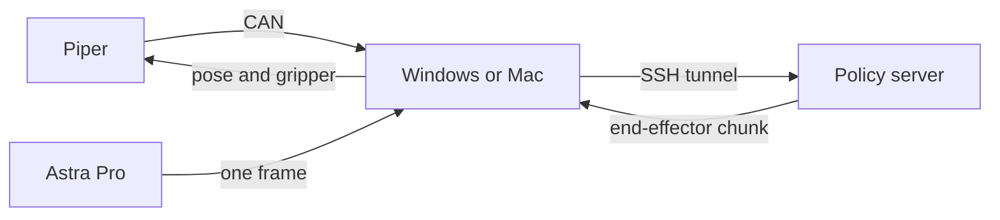

# CEI robot arms

A Windows or Mac computer reads an AgileX Piper and one Orbbec Astra Pro color camera, sends the observation to a policy server over an SSH tunnel, and executes each returned end-effector chunk until you press `Ctrl+C`. Server account, host, and checkpoint live in `team_config.json`. This repository does not hard-code them.

本机可以是 Windows 或 Mac。它经 candleLight 读取 AgileX Piper，用 Orbbec Astra Pro 拍一张彩色图，把这一帧作为观测图像，经 SSH 隧道发给计算节点上的策略服务。服务每次返回一段末端增量。本机按底座坐标执行，然后重新观测，直到按 `Ctrl+C`。Mac 上用仓库里的 `.venv/bin/python`，并先按开发文档安装 libusb。

操作步骤看 [`用户文档.md`](用户文档.md)，英文版是 [`USER_GUIDE.md`](USER_GUIDE.md)。改观测、动作映射或 CAN 协议时看 [`开发文档.md`](开发文档.md)，英文版是 [`DEVELOPER_GUIDE.md`](DEVELOPER_GUIDE.md)。训练数据采集的规定看 [`数据采集.md`](数据采集.md)。服务器上怎么加载微调数据看 [`服务器训练对接.md`](服务器训练对接.md)，英文版是 [`SERVER_TRAINING.md`](SERVER_TRAINING.md)。



## Start

Fill `team_config.json`, then run these commands in this folder. On a Mac, use `.venv/bin/python` instead of `python`.

```powershell
python team_config.py show
python team_config.py run
```

`run` submits or reuses the `serve-policy` job, opens the local forward, and starts the control loop. The arm moves. Press `Ctrl+C` and wait for `stopped`. While the server and the forward are still up:

```powershell
python team_config.py once
```

Stop the job and the forward with `python team_config.py down`. Check the arm without moving it with `python team_config.py arm`. Preview the camera with `python policy_link.py preview` (press q to close).

On Windows, close ArmRobot before any of these commands. Leave drag-teach before `run` or `once`. While status stays `TEACHING` with `teach=1`, pose commands are ignored. Edit the `prompt` string in `policy_link.py` before a run.

To record a drag-teach episode, turn drag-teach on first, then run `python collect.py --task "put the pen in the box"`. A window shows the camera. Press `s` when the attempt succeeds. That also rebuilds `datasets/piper_finetune`. See `用户文档.md`. To replay the newest recording on the arm, run `python policy_link.py replay` (add `--loop` to repeat it).

Python packages used here are `numpy`, `opencv-python`, `msgpack`, `websockets`, `python-can`, and AgileX's `pyAgxArm` (`pip install "git+https://github.com/agilexrobotics/pyAgxArm.git"`). Recording also needs `pandas` and `pyarrow`. Mac also needs `pyusb`, `pyobjc-framework-AVFoundation`, and `brew install libusb`. All CAN traffic goes through `pyAgxArm`; `piper_can_bus.py` lets it use the candleLight over USB on Windows and macOS.

## Files

| File | Role |
| --- | --- |
| `team_config.json` | Your own login account, SSH host, checkpoint, and Slurm settings. Copy it from `team_config.example.json`; it is gitignored because the repository is public |
| `team_config.py` | `run`, `once`, `down`, `arm`, and `setup-remote`. `--server` selects `simple`, `replay`, or `openpi` |
| `policy_link.py` | Observation, WebSocket loop, Astra Pro capture (`VID_2BC5` `PID_0501`), plus `preview`, `cameras`, `ready`, and `home` |
| `simple_policy_server.py` | Scripted server for a link test, joint demo, or episode replay |
| `policy_step.py` | Turns one 12-d chunk into base-frame pose commands |
| `piper_client.py` | Arm client on the official `pyAgxArm` SDK |
| `piper_can_bus.py` | CAN backend per platform for `pyAgxArm` |
| `check_candidate_repo.py` | Search a candidate policy repo before changing the action mapping |
| `_can_listen.py` | Receive-only CAN capture |
| `collect.py` | Record, check, export, and rebuild `datasets/piper_finetune` after `s`. `--latest` does that for the newest episode |
| `episode_recorder.py` | Read-only drag-teach episode: arm feedback, one Astra frame, start and success or failure |
| `episode_check.py` | Print the episode timeline and save pose curves beside frames |
| `dataset_export.py` | Resample a successful drag episode to 0.05 s. Intervals that are not teach mode, lack a fresh image, or jump are masked |
| `prepare_dataset.py` | Pack every successful export into `datasets/piper_finetune` for the server fine-tune |

The current 12-d mapping is for one end-effector delta policy: translation, rotation, and gripper in the arm base frame. Base, torso, and mode values are dropped. A different checkpoint needs a new `action_waypoints()`.
