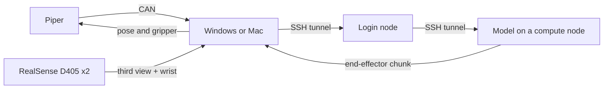

# User guide: send Piper state to a policy server

This guide is for people operating the arm. To change code, observation fields, or the CAN protocol, read `DEVELOPER_GUIDE.md`. The Chinese version is `用户文档.md`.

What this does: a Windows or Mac computer reads the arm, captures one third-view frame and one wrist frame from two Intel RealSense D405 cameras, sends both as the observation through the local SSH tunnel, and starts the next chunk. Each reply is an end-effector chunk. The computer plays it in the arm base frame, then reads a new state and new frames and requests the next chunk, until you press `Ctrl+C`. The cameras, firmware, cluster, and directory layout for this rig are defaults in `team_config.py`. `team_config.json` names the account, the policy config, and the checkpoint. On a Mac, use `.venv/bin/python` wherever this guide says `python`.



## Find a task

| You want to | Go to |
| --- | --- |
| Run the whole link for the first time | [Run once](#run-once) |
| Check that the arm is online without moving it | `arm` in [Run once](#run-once) |
| Decide whether a run succeeded | [What success looks like](#what-success-looks-like) |
| Read the printed numbers | [What the output means](#what-the-output-means) |
| Look up an error | [When something fails](#when-something-fails) |
| Pause this run, or stop the server | [Stop this test](#stop-this-test) |
| Record a demonstration by dragging the arm | [Record a demonstration](#record-a-demonstration) |
| Train and run a ten-take pi0.5 baseline | [Baseline: ten demonstrations to a pi0.5 check](#baseline-ten-demonstrations-to-a-pi05-check) |
| Power off the arm after use | [After you finish](#after-you-finish) |

## Before you start

- On Windows, close ArmRobot first. While it is open, this computer cannot open the CAN adapter.
- Power the arm and plug the CAN cable into the arm's CAN port.
- Run every command in this folder. This folder is wherever you unpacked the code, not someone else's desktop path. On Windows use `python`. On a Mac use `.venv/bin/python`.
- Copy `team_config.example.json` to `team_config.json` and fill `remote_user`, `policy_config`, and `checkpoint_dir`. The real file is gitignored because the repository is public. Anything else in that file replaces the matching default; leave a key out to keep the default.
- The login node is `athena.egr.duke.edu`. Set `ssh_host` only when your `.ssh\config` already has a Host for it. Logs go to `~/logs` and the checkout is `~/skipconnect-pi05-robocasa/third_party/openpi`.

## On a Mac

Run the one-time setup in the developer guide (`brew install libusb` and the `.venv`, which includes `python-can` and `pyAgxArm`), then use `.venv/bin/python` in place of `python` below. Before the first run:

1. Allow camera access for Terminal (System Settings > Privacy & Security > Camera). This rig's `third_view_serial` and `wrist_serial` are already the defaults. Confirm the two are not swapped before recording: `python _realsense_test.py` writes labelled pictures to `_camera_test/`, and `policy_link.py cameras --motion-check` reports which camera moves when you move the arm (that one is the wrist view). `policy_link.py preview` shows both streams live (q closes the windows).
2. With `server_mode` set to `"simple"`, `.venv/bin/python team_config.py setup-remote` copies the test server to athena once. Fill `slurm_partition` first.
3. Leave room around the arm. The test server moves the end effector 10 mm along +X and back each chunk and opens or closes the gripper. A chunk farther than `max_chunk_shift_mm` from its start is refused before anything is sent.

The local forward runs in the background instead of a `piper-link` window. `down` closes it.

For joint-space chunks (the demo server), two flags tune smoothness and can be compared run to run; `team_config.py once` and `run` accept them too:

```bash
.venv/bin/python policy_link.py once --port 8000 --freq 100 --speed 60
```

`--freq` is how many times per second the joint target changes (default 100; 20 is the old stepwise behavior). `--speed` is the joint speed percent (default `joint_speed` in `team_config.json`). Each chunk prints the values it used.

### Replay one recording on this computer

```bash
.venv/bin/python policy_link.py replay episodes/episode_...
```

Without a folder it plays the newest recording. No server is needed. A window shows the camera live (`--no-preview` hides it; over SSH there is no window). The arm unfolds to the ready pose (where every recording starts), moves slowly to the recording's first pose, plays it once, prints `replay_done`, and returns to the ready pose. Add `--loop` to keep replaying it, back through the ready pose each time, until `Ctrl+C`. The gripper follows the recording, 10% of its full stroke narrower than recorded so it still grips (stopping on the object), and opens fully wherever the recording was more than 75% open; the stroke is read from this arm. Joints dragged past their limits (J5 beyond 70 degrees) are held at the limit. Leave drag-teach first. Recordings made on a Mac replay the same on Linux: copy the episode folder over.

### Replay a recording from the server

1. Record a demonstration as in [Record a demonstration](#record-a-demonstration). Any episode can be replayed, not only ones marked `s`.
2. Set `replay_episode` to that folder (for example `episodes/episode_20261019_160000`) and copy it to the server: `.venv/bin/python team_config.py setup-remote`. It uploads the joint angles and gripper as an `.npz`, so the server needs no pandas.
3. Leave drag-teach, then run `.venv/bin/python team_config.py run --server replay`. The first chunk moves slowly to the recording's first pose; then each chunk plays the next 2.5 s. Parts moved by hand faster than about 48 degrees/s replay slower. The run ends with `server_done`. Add `--loop` to the server command in `team_config.py` to repeat it. The server cannot ask the arm for its gripper stroke, so it uses `gripper_stroke_mm` from `team_config.json` (default 70; set 100 on a 100 mm gripper).

### Run the model

`--server openpi` serves the checkpoint in `checkpoint_dir` with `openpi_python` on a GPU; `mode_overrides.openpi` holds its partition, memory, and time. The first reply can take minutes while the model compiles.

Before a first real run, check the link without moving the arm. This sends real observations with both camera frames and the arm state, prints what went out and what came back, and applies nothing:

```bash
.venv/bin/python team_config.py run --server openpi --observe-only --cycles 3
```

The arm must not move at all. Each cycle prints one `observation/image` line, one `observation/wrist_image` line with a different mean, `third_vs_wrist_mad` well above 1.0, the decoded `observation/state`, and then the returned chunk: `actions shape=(50, 12)`. A `WARNING` about an all-zero chunk means the server is still the placeholder. A string reply instead of a chunk is the server's own exception text, so it names the observation key it did not like. `observation/right_image is required for pi05` means the checkpoint's adapter is still the three-camera RoboCasa one: this rig has one scene camera and one wrist camera, so run `.venv/bin/python team_config.py patch-remote` once (it changes that one branch to pad and mask `right_wrist_0_rgb`, as the DROID adapter does), then `down` and start the server again. When that looks right, run the loop for real:

```bash
.venv/bin/python team_config.py down
.venv/bin/python team_config.py run --server openpi --ready
```

`--ready` unfolds the arm to the ready pose first, because end-pose chunks from the folded pose only move the gripper. This model was trained in simulation: its full 50-step chunk integrates to 0.3–1.5 m, far more than the simulated arm moved. `execute_steps` (here 10) keeps only the first steps and `ee_delta_scale` (here 0.1) shrinks each one; with these, about 3 of 4 chunks stay within `max_chunk_shift_mm`. A chunk outside it prints `chunk_refused`, sends nothing, and the loop observes again. Expect small motions, not a finished task. Switching between `simple`, `replay`, and `openpi` needs `down` first; `run` refuses a job started in another mode. `.venv/bin/python policy_link.py ready` only unfolds the arm. `.venv/bin/python policy_link.py home` folds it back to just above the rest pose (`home_deg` in `team_config.json`, default J2 10°, J3 −5°) at the same slow speed, gripper open; it needs no server. Do not set any joint of `home_deg` at its mechanical stop: that trips the joint driver, and then the arm ignores joint commands until it is power-cycled. A move of more than `max_chunk_joint_deg` is refused; then move the arm closer by hand in drag-teach first.

## Do not

- Do not run `run` or `once` while drag-teach is still on. While status stays `TEACHING` with `teach=1`, end-effector commands are ignored. Leave teach mode first so status can enter `CAN_CTRL`.
- Leave room around the arm. `execute_steps` and `ee_delta_scale` shorten and shrink the chunk first. A chunk farther than `max_chunk_shift_mm` from its start is refused before anything is sent.
- The language instruction is the `prompt` field in `policy_link.py`. Change that English sentence before a run. There is no separate command-line prompt.
- Do not install a fresh environment on the compute node. Use the Python already installed under `openpi_dir`.
- Do not copy a job script or an SSH forward from this guide onto the login node. `run`, `once`, and `down` connect by themselves.
- Do not run `run` or `once` while recording a demonstration. The cameras are busy.

## Record a demonstration

This stores a person dragging the arm (recording with a leader arm is at the end of this section). First the program moves the arm to the ready pose, so every recording (and its replay) starts from the same place; add `--no-ready` to skip that. Then it asks you to turn on drag-teach and press Enter. While recording it only reads the arm and the two cameras, and a window shows the third view and the wrist view side by side (`--no-preview` hides it; over SSH there is no window). Run this in this folder with the task sentence in quotes (on a Mac use `.venv/bin/python` and `/` in paths):

```powershell
python collect.py --task "put the pen in the box"
```

When the attempt is over, press one key in the terminal or the camera window (no Enter needed):

| Key | Result |
| --- | --- |
| `s` | Success. The episode is checked, exported, and every successful episode is packed into `datasets/piper_finetune` |
| `f` | Failure, kept but not exported |
| `d` | Discard |

The folder name is filled in by the program. Do not copy it into another command. `teaching_fraction` should be close to 1 and `frames_missing` should be 0. After `s`, that episode's `export` folder is printed, and the fine-tune pack is `datasets/piper_finetune`. Flagged steps stay out of the pack. How to load it on the training machine is in `SERVER_TRAINING.md`. The collection rules are in `数据采集.md`.

To check and export the newest episode already on disk:

```powershell
python collect.py --latest
```

### Record with a leader arm

The leader arm and this (follower) arm share one CAN bus and one adapter. Both grippers must be ID10, and the leader/follower roles must already be set in the host software. Power on the follower first, then the leader, then run:

```powershell
python collect.py --leader --task "put the pen in the box"
```

With the leader on the bus, both arms answer the firmware-version query and the replies interleave, so the version cannot be told apart. The raw frames are the same mix, and the first version string in them can be the leader's, so `create_piper_arm()` does not guess. This follower is `v189`, which is already the default. Set `piper_firmware` in `team_config.json` only for a different arm. `v189` covers S-V1.8-9 and later; see `DEVELOPER_GUIDE.md` for the others.

The other two messages come from the same place: `no CAN frames from the arm` means the adapter sees nothing at all (arm off, or another program holding the adapter), and `the arm answered the feedback stream but not the firmware query` means the frames arrive but the query is never answered.

The program does not move the arm in this mode. Use the leader to bring the follower to the start pose, press Enter to start recording, and finish with the same keys as above. Recording only reads the bus and the two cameras. The leader's commands are stored as well, but they are only a diagnostic (leader firmware 2.0.7 no longer sends 0x155–0x157/0x159, so the `lead_*` columns stay NaN and `leader_missing_share` is 1.0; that is expected): they never become a training label and the export never decides anything from them. `teaching_fraction` is now the share of time the follower is in a following mode and should be close to 1; if it is 0, send that episode's `mode_changes` to whoever maintains the code. What the export does refuse is a take where **the follower itself never moved**: `follower_path_mm` under 10 mm with less than 5° of rotation means nothing ever commanded or dragged the arm, and `episode_check.py` prints that number right after recording. Before inference, unplug the leader (its commands would fight the policy's), set the former leader back to follower mode, and power-cycle it.

### Demo window

`demo.py` puts everything above in one window, for showing the rig. Power on the follower first, then the leader, then run (on a Mac `.venv/bin/python`):

```bash
python demo.py --task "put the pen into the box"
```

No `sudo` is needed. The window shows the third view and the wrist view side by side and the follower's mode, joints and gripper. While the leader is on, the follower follows it; that is the arms' own firmware, the program sends nothing. The program cannot see the leader: on leader firmware 2.0.7 it no longer broadcasts the 0x155–0x157 joint frames (it drives the follower with 0x1C0–0x1C3, which this code does not interpret), so you confirm the leader's power yourself. Keys:

- `r` records one leader/follower take like `collect.py --leader` (s success, f failure, d discard). Both views are saved side by side as `recording.mp4` in the episode folder. A success is checked, exported, and packed into `datasets/piper_finetune`; a take in which the follower never moved is refused there. The `lead_*` columns stay empty with this leader firmware; they are only a diagnostic.
- `p` replays the newest successful take on the follower only, like `policy_link.py replay`: ready pose, the take, ready pose. The window first asks you to **power the leader off** and press `y` (any other key cancels). The cameras during the replay are saved as `replay_YYYYmmdd_HHMMSS.mp4` in the same episode folder. Before powering the leader on again, pose it near the follower's ready pose, because the follower jumps to the leader's pose at once.
- `q` or Esc quits.

Recording and replay open the cameras and the arm themselves, so the live window closes while they run and comes back afterwards.

### Baseline: ten demonstrations to a pi0.5 check

About 10 successful leader/follower takes only prove the pipeline: the data loads, the loss falls, and the arm moves the right way. A usable policy needs dozens to hundreds of takes with the pen and the box in varied positions.

**Record** into a folder of its own (on Windows `python`):

```bash
.venv/bin/python demo.py --out episodes/baseline_10
```

Only `episode_*` folders directly under `--out` are read, so older takes in `episodes/` are not mixed in. After each `s`, `datasets/piper_finetune` is rebuilt from that folder alone and replaces whatever was there before. Keep only `s` takes. Start each take near the same pose and vary where the pen and the box sit.

**Check** the count in `datasets/piper_finetune/meta/info.json`: `total_episodes` counts one dataset episode per contiguous valid segment, so it can be larger than the number of takes. Read the `episode_check.py` output printed after each take. To see that a take replays, press `p` in the same demo window (leader powered off); it plays the newest success under `--out`.

**Archive.** `episodes/` and `datasets/` are gitignored and never committed. Copy both to the team OneDrive folder "CEI Robotics data" under a date folder such as `11_03/`, with `episodes/` and `datasets/` inside it.

**Train.** Copy only `datasets/piper_finetune` to the cluster and follow [SERVER_TRAINING.md](SERVER_TRAINING.md): config `pi05_piper_finetune` with `Pi0Config(pi05=True, action_horizon=50, action_dim=32, discrete_state_input=True)`, skip the Panda reorder (`already_in_model_order`), normalize with `meta/stats.json`, feed the two image keys, and save to a new checkpoint directory. These server-side changes are not in this repository. Start training with openpi's own entry point as a Slurm GPU job:

```bash
uv run scripts/train.py pi05_piper_finetune --exp-name=baseline10 --overwrite
```

A few thousand steps are enough to see the loss fall.

**Run it.** Set `policy_config` and `checkpoint_dir` in `team_config.json` to the new config and checkpoint, unplug the leader, set the former leader back to follower mode, and power-cycle it (see "Record with a leader arm" above). Check the link first (expect `actions shape=(50, 12)` and no motion), then `once --ready` runs the policy on the same server and moves the arm:

```bash
.venv/bin/python team_config.py run --server openpi --observe-only --cycles 3
.venv/bin/python team_config.py once --ready
```

Keep `execute_steps` and `ee_delta_scale` small. `check_limits()` refuses any chunk outside `max_chunk_shift_mm` or `workspace_mm` and prints `chunk_refused`.

## Run once

Copy `team_config.example.json` to `team_config.json` and fill in the account, the policy config, and the checkpoint directory. The cameras, port, partition, and time are already set for this rig. See the merged result:

```powershell
python team_config.py show
```

Then, in this folder, run:

```powershell
python team_config.py run
```

`run` does the rest:

1. Connect to the login node. When it asks for a password, type it in this window. The characters are not shown.
2. Submit a job named `serve-policy` when you do not already have one, and reuse it when you do. `--port` is placed before `policy:checkpoint`.
3. Check the job about every 10 seconds. After the log says the server is listening, read the compute-node address. Warnings from a simulator while the model loads can be ignored for now. Do not SSH into the compute node; SSH can hang while the node is busy.
4. Open the local forward. On Windows this is a window titled `piper-link`: type the SSH password once more there, then leave it open. On a Mac the forward runs in the background and there is no window.
5. Read the arm and both D405 cameras, send one observation, execute the chunk after `execute_steps` and `ee_delta_scale`, then start the next chunk. The port is `local_forward_port`. The arm moves. Press `Ctrl+C` to stop the loop.

While the server and the forward are still up, start another continuous run without submitting again:

```powershell
python team_config.py once
```

To check that the arm is online without contacting the server:

```powershell
python team_config.py arm
```

Success: the output contains `complete=True`, six joint angles, a gripper opening in millimeters, and an end-effector pose. The arm does not move.

## What success looks like

These lines appear first:

```text
server_connected
observation_sent
waiting_for_inference
```

After `waiting_for_inference`, the first model compilation can take several minutes. The run should then show `cycle=1`, the `observation/image` and `observation/wrist_image` lines with different means, `third_vs_wrist_mad`, `complete=True`, `actions shape=(50, 12)`, `command_steps=50`, and `pose_sent`. Both means should be well above 0. After a chunk, `after` prints the new pose and `cycle=2` starts.

A chunk that reached its target shows `CAN_CTRL` and `motion=0`. The pose under `after` should be close to the `target_mm_deg` printed for that chunk. If the server reports a missing observation field, `build_observation()` does not yet match that model. See the developer guide.

## What the output means

| Printed text | Meaning |
| --- | --- |
| `joints_deg` | Current angle of the six joints, in degrees |
| `gripper_mm` | Gripper opening, in millimeters |
| `pose_mm_deg` | End-effector position in millimeters and orientation in degrees |
| `complete=True` | Joints, gripper, pose, and status were all received |
| `observation/image` | Shape, dtype, and average brightness of the third-view D405 frame after padding to 224×224. It is sent under that key and reaches `base_0_rgb` |
| `observation/wrist_image` | The same for the wrist D405 frame. It is sent as `observation/wrist_image` and reaches `left_wrist_0_rgb`. A mean near 0 means that camera returned an empty frame |
| `third_vs_wrist_mad` | Mean absolute difference between the two model inputs. Under 1.0 means both slots carry the same picture, so the camera serials are the wrong way round |
| `observation/state` | The 16 numbers sent as `observation/state`: position in mm, quaternion xyzw, six static body dims that must stay 0, and the gripper split into two finger openings in mm |
| `actions shape=(50, 12)` | Shape of the chunk that came back. `translation_mm_total` and `rotation_deg_total` are what the whole chunk would move if it were applied |
| `cycle` | Which chunk this is. Each chunk captures a new frame and requests a new inference |
| `command_steps` | How many steps of this chunk were sent. With `execute_steps` empty, every step the model returned is sent |
| `shift_mm` | Total end-effector translation of this chunk, in millimeters |
| `target_mm_deg` | Target pose of the last step in this chunk |
| `pose_sent` | The pose commands for this chunk have been written |
| `after` | Joints, gripper, and pose read back after the chunk |

The current mapping reads the model output in the arm base frame: the first three values are end-effector translation, the next three are rotation about the base axes, and the next value is the gripper. Base, torso, and mode values have no mechanism on this arm and are not sent. Re-check that meaning in the developer guide after changing models. The language instruction is not typed on the server.

## Stop this test

`run` and `once` keep looping. Press `Ctrl+C` in that window. After `stopped` appears, the prompt returns. The policy server and the local forward stay up, and the compute node keeps the GPU. On Windows the forward window is titled `piper-link`.

To stop the server and release the GPU:

```powershell
python team_config.py down
```

This cancels `serve-policy` jobs under your account and closes the local forward. Type the SSH password in this window when asked.

A server you started by hand on the GPU machine is not a job. Press `Ctrl+C` in that server window, then run `down` to close the local forward.

After the software has stopped, power off the arm as described in the next section.

## After you finish

Confirm that `python team_config.py down` has finished, then follow this order:

1. Press the button on the arm once, and wait until the green light stays on.
2. Drag the arm back to the zero pose by hand. The zero pose is on page 6 of the user manual.
3. Press the button again, and wait until the green light turns off.
4. Unplug the power after the green light is off.

## When something fails

| What you see | What it means | What to do |
| --- | --- | --- |
| Fill these keys in team_config.json | Some config fields are still empty | Fill the listed keys, then run `python team_config.py show` |
| A direct connection from this computer to the server port times out | The login node often does not expose the policy port | Run `python team_config.py run`. It forwards to the compute-node address |
| On Windows, the `piper-link` window sits there with no prompt | The forward is up | Leave that window open and return to the first one. On a Mac the forward is in the background and there is no window |
| Enter after the password only moves to the next line | The forward window does not open a shell | Press Enter once for the password |
| `channel ... Connection timed out` | The forward is aimed at a compute node that is no longer listening | Run `python team_config.py down`, then `python team_config.py up` |
| The log says `--port` is unrecognized | An older launch script was used | Run `python team_config.py run` again |
| The log fails while compiling `av` | The wrong Python is being used | The launch command uses `.venv/bin/python`, not `uv run` |
| The server reports a missing `observation` field | The observation does not match this model | Change `build_observation()` as described in the developer guide, and do not execute the actions |
| On Windows, red text like `python : waiting state=PENDING` with `NativeCommandError` | This is not a failure. Windows PowerShell 5.1 reports anything a native command writes to stderr as an error record, and `2>&1` in your own command is what routes it there | Drop `2>&1`: `python team_config.py run ... \| Tee-Object -FilePath _camera_test\rollout_log.txt`. The program itself no longer writes to stderr |
| `timed out in 5.0s` | An older client did not wait long enough for the model | Use the current program; it prints `waiting_for_inference` first |
| The log shows the job already exited | The server is not still on the compute node | Read the log tail printed by `run`, fix the config, and run `run` again |
| On Windows, CAN cannot be opened, error 5 | ArmRobot, VMware, or a Python process from an earlier run owns the adapter | Close ArmRobot. If it still fails, unplug and replug the candleLight, then see device ownership in the developer guide |
| Status stays `TEACHING` and the pose does not change | Drag-teach is on, so pose commands are ignored | Leave teach mode, then run `once` |
| On Windows, exit code `3221225477` | An access violation occurred when the camera and CAN writes shared one process | Use the current program. Motion is sent from a separate process |
