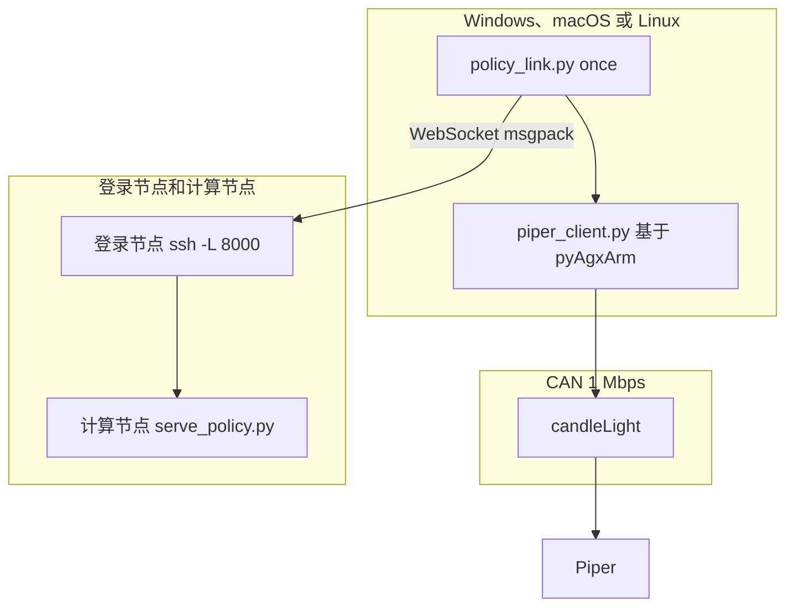

# 开发文档：Piper 客户端与策略链路

这份文档给要改代码或查协议的人。操作步骤在 `用户文档.md`。英文版是 `DEVELOPER_GUIDE.md`。



## 从这里找

| 要改或要查的内容 | 位置 |
| --- | --- |
| 只读状态、夹爪动作 | [piper_client.py](#piper_clientpy) |
| 各平台的 CAN 后端、固件配置 | [官方 SDK（pyAgxArm）](#官方-sdkpyagxarm) |
| 发给模型的字段 | [观测契约](#观测契约) |
| 模型返回后怎么变成末端指令 | [动作契约](#动作契约) |
| WebSocket 和超时 | [策略链路](#策略链路) |
| 设备打不开 | [设备占用](#设备占用) |
| CAN 帧格式和 ID | [协议](#协议) |
| 已经证明走不通的库 | [不要换的入口](#不要换的入口) |
| 还没做的功能 | [边界](#边界) |
| 拿到一个候选策略仓库 | [候选仓库核对](#候选仓库核对) |

## 仓库里用哪几个文件

| 文件 | 职责 |
| --- | --- |
| `piper_client.py` | `PiperClient`：官方 `pyAgxArm` SDK 外面的一层薄封装，单位是度和毫米。`read_state()`、`driver_faults()`、夹爪、退出示教、使能、MOVE J、MOVE P。见 [piper_client.py](#piper_clientpy) |
| `piper_can_bus.py` | 按平台选 CAN 后端和固件配置；在 Windows 和 macOS 上经 USB 直接驱动适配器。见 [官方 SDK（pyAgxArm）](#官方-sdkpyagxarm) |
| `policy_link.py` | 组观测、保持一条 WebSocket，循环推理。相机和 CAN 写不放在同一个进程 |
| `policy_step.py` | 把一段动作积成底座坐标下的末端轨迹并写到 CAN |
| `team_config.json` | 登录账号、SSH 别名、checkpoint 和日志目录。从入库的空模板 `team_config.example.json` 复制一份；真实文件在 `.gitignore` 里，因为仓库是公开的 |
| `team_config.py` | `run` 提交作业、等待监听、打开一条本机转发并开始连续控制。`once` 在转发已开时再开始一轮。`down` 取消作业并关掉转发。`job` 和 `serve` 仍只打印命令 |
| `simple_policy_server.py` | 不带模型、测试链路用的脚本化策略服务器。见 [macOS 与简单服务器](#macos-与简单服务器) |
| `用户文档.md` | 操作步骤 |
| `_can_listen.py` | 只接收、不发送的抓包。日志写在本目录的 `_can_listen_log.txt` |
| `check_candidate_repo.py` | 拿到候选策略仓库后先检索配置、动作、归一化、相机和 Piper 执行代码 |
| `prepare_dataset.py` | 把成功的示教整理成 `datasets/piper_finetune`。服务器改动见 `服务器训练对接.md` |

路径都相对于这份代码所在的目录。不要在文档或新代码里写某个人的桌面绝对路径。服务器路径以 `team_config.json` 为准。

所有 CAN 通信都经过松灵的 `pyAgxArm`。旧的 `piper_sdk` 和 `piper_ros` 不使用，也不在这个仓库里。

## 官方 SDK（pyAgxArm）

`pyAgxArm` 是松灵目前的官方 Python SDK，支持 Piper 和 Nero。它打开总线只用 `python-can` 的 `can.interface.Bus(interface=..., channel=..., bitrate=...)` 这一处。官方针对各平台的路线：

| 平台 | 官方路线 | 对本仓库的 candleLight（gs_usb，`1D50:606F`） |
| --- | --- | --- |
| Linux | `socketcan`，`can0` | 能用 |
| Windows | `agx_cando`（`cando.dll`） | DLL 里没有这个适配器的 WinUSB GUID，大概是给松灵另一款模块的。未测试 |
| macOS | `slcan`，`/dev/ttyACM0` | 不能用：这个适配器不提供串口 |

`piper_can_bus.py` 补上缺口：它注册一个名为 `piper_usb` 的 `python-can` 接口，经 USB 直接驱动适配器（Windows 上用 ctypes 调 WinUSB，macOS 上用 pyusb 调 libusb），把 `can.Message` 和 20 字节 gs_usb 帧互相转换，并丢掉发送回显。pyAgxArm 的代码不改。

```python
from piper_can_bus import create_piper_arm
robot = create_piper_arm()   # Linux 且有 can0：socketcan；否则 piper_usb
robot.connect()
```

- `can_args()` 选接口和通道：`/sys/class/net/can0` 存在时用 `socketcan` / `can0`（`PIPER_CAN_INTERFACE` 可指定别的接口名），否则用 `piper_usb`。
- Linux 上接口关闭时（比如重新插拔后），`bring_up_can()` 把它设为 1 Mbps 并打开，需要 root。
- `create_piper_arm()` 向臂查询固件版本（只是查询，不动臂），再用 `resolve_firmware_profile()` 选驱动配置；传 `firmware=` 可以跳过。查询前先等反馈到达，因为在反馈频率测出来之前，`get_firmware()` 会丢掉收到的回复。
- `open_bus()` 在同一个适配器上返回一个普通的 `python-can` 总线，给 `_can_listen.py` 用。

pyAgxArm 有一个后台线程持续解析所有反馈帧，读取时立刻拿到最新值。它的单位是弧度和米，`PiperClient` 换算成度和毫米。

绝不调用 `calibrate_gripper()` 和 `calibrate_joint()`：它们发送 `0xAE`，会把当前位置写成零点。

已验证的部分：

- IQ9075（Linux，socketcan）：`read_state()`、`driver_faults()`、`gripper_max_mm()`、`team_config.py arm` 和 `_can_listen.py`（25 s 收到 58,026 帧，高速反馈每个 ID 约 200 Hz）。用 pyAgxArm 的 `enable()`、`set_speed_percent(20)` 和 `move_j` 让 J1 转 +10° 再转回，驱动器没有故障。固件 `S-V1.9-0` 对应配置 `v189`。
- macOS 接真实适配器：pyAgxArm 经 `piper_usb` 读到的关节、法兰位姿和固件与 IQ9075 上一致，反馈约 200 Hz。
- 离线用假适配器：`PiperClient` 发出退出示教 `0x150`（第 2 字节 `0x02`）、使能 `0x471`、经 `0x151` 切到 MOVE J、插值后的 `0x155`–`0x157`，以及设零字节为 `0x00` 的夹爪 `0x159`。
- 还没跑：经新 `PiperClient` 的 `ready`/`home` 和策略 chunk，以及 `piper_usb` 接真实的 Windows 适配器。

安装：`pip install python-can "git+https://github.com/agilexrobotics/pyAgxArm.git"`，macOS 上另外要 `pyusb` 和 `brew install libusb`。IQ9075 上没有 pip，把 `python-can`、`packaging`、`typing_extensions`、`wrapt`（aarch64）和 `pyAgxArm` 的 wheel 解压到 `.pylib`。那里的 Python 没有 `sqlite3`，而 `python-can` 会为一个本项目用不到的日志写入器导入它；在 `.pylib` 放一个占位的 `sqlite3.py` 即可。

## piper_client.py

`PiperClient` 是上下文管理器。`connect()` 调用 `create_piper_arm()`，启动 pyAgxArm 的线程，并初始化松灵夹爪 effector。`close()` 停掉线程、释放适配器；它不失能机械臂，臂会保持当前姿态。

`read_state(timeout=0.6)` 返回最新反馈，连接后最多等 `timeout` 让反馈到达。超过 0.5 s 没更新的反馈按缺失处理。下面每个字段都有时 `complete` 才为 True：

| 字段 | 来源 | 单位 |
| --- | --- | --- |
| `joints_deg` | `get_joint_angles()`（`0x2A5`–`0x2A7`） | 度 |
| `gripper_mm` | 夹爪 `get_gripper_status()`（`0x2A8`） | 毫米 |
| `gripper_effort` | 同上，力 | 0.001 N·m |
| `gripper_status` | 同上，状态字节 | 原始值 |
| `pose_mm_deg` | `get_flange_pose()`（`0x2A2`–`0x2A4`），`x y z rx ry rz` | 毫米和度 |
| `status` | `get_arm_status()`（`0x2A1`） | 见协议一节 |

状态名字（`TEACHING`、`CAN_CTRL` 等）取自 `piper_client.py` 里的表，不用 pyAgxArm 的名字，所以录好的 episode 和 `dataset_export.py` 里的字符串不变。

`driver_faults()` 读六个关节的 `get_driver_states()`，返回 `{关节: [故障名]}`；没有新反馈的关节报 `no feedback`。

`gripper_max_mm()` 向夹爪查询配置的行程（`get_gripper_teaching_pendant_param()`）。70 或 100 时采用，否则回退到 70。有一台臂回复 100。

`move_gripper(target_mm, effort=1000)` 只发夹爪命令，约每 10 ms 重发一次，直到反馈与目标相差 1 mm 以内或超过 4 秒。目标限制在 0–100 mm，力矩限制在 0–5000。它不使能关节，设零字节保持 0。

`exit_drag_teach()` 用 pyAgxArm 的 `0x150` 消息（第 2 字节 = `0x02`，结束拖动示教记录）连发五次。pyAgxArm 没有对应的公开接口，所以用了驱动的 `_send_msg`。它不是急停，也不写零点。`enable_arm()` 调用 `enable()`。

`move_joints(...)` 先按 `JOINT_LIMITS_DEG` 检查目标，用 `set_speed_percent()` 设速度，然后在 `duration` 内每 5 ms 调一次 `move_j`，目标从 `start_deg` 插值，每秒更新 `update_hz` 次。`move_pose(...)` 在 `duration` 内每 10 ms 调一次 `move_p`。两者都能在同一个循环里重发一个夹爪命令。

`0x2A1` 控制模式为 `0x02`（`TEACHING`）且示教字节为 `0x01` 时，末端位姿命令不会执行。低速反馈 `0x261`–`0x266` 第 6 字节的 bit 6 表示该关节驱动器已使能。

在 Windows 上，相机和 CAN 写放在同一个进程会以 access violation（`3221225477`）退出，所以机械臂放在单独的进程里。`policy_link.MotionWorker` 每次运行只启动一次 `policy_step.py worker`；这个进程只连一次机械臂，通过 stdin/stdout 上的 pickle 元组响应读状态和执行 chunk，打印走 stderr。`policy_link.py` 只保留相机：`LiveCamera` 一直开着，后台线程只保留最新一帧。以前每轮都要重开相机、连两次机械臂（每次都识别固件），还在最后一个目标上停 0.5 s，两个 chunk 之间停 1–3 s；现在只剩几十毫秒加推理时间。

## 策略链路

`policy_link.py` 使用和 `openpi_client` 相同的 WebSocket：连接后服务器先发一条 msgpack 元数据，之后每次观测一条 msgpack，回复也是一条 msgpack。NumPy 用 `__ndarray__` 字段传输，键为 bytes：`data`、`dtype`、`shape`。

服务器目录、账号、主机名和模型名只放在每个人自己的 `team_config.json`。缺字段时 `team_config.py` 会列出要填的键，不会套用别人的路径。操作员执行 `python team_config.py run`：它在登录节点提交或复用名为 `serve-policy` 的作业，等日志出现 `listening on`，用 `scontrol` 的 `NodeAddr` 从本机做一条 `ssh -L`，然后调用 `policy_link.py once`。Windows 上转发窗口留着；macOS 上转发在后台，`down` 用 `pkill` 关掉。`down` 取消该用户名下的 `serve-policy` 作业并结束本机对应的 `ssh -N`。`job` 和 `serve` 仍只打印文本，给需要手工启动的人。

`once` 的顺序：

1. 最多重试 50 次连接 `ws://host:port`，单次握手超时 2 秒。`python team_config.py once` 和未写 `--port` 的 `python policy_link.py once` 都使用 `local_forward_port`。`python policy_link.py serve` 仍默认监听 `127.0.0.1:8765`，那是本机占位服务。
2. 30 秒内接收元数据，打印 `server_connected`。
3. 向运动进程要 `read_state()`。不完整就抛错，不发送。
4. `LiveCamera.read_bgr()` 返回调用之后拍到的第一帧，`model_image()` 把它转成 RGB 并填充到 224×224；相机是 Orbbec Astra Pro 的彩色相机（USB `VID_2BC5` `PID_0501`），同一台电脑上的其他摄像头不会被选中。`build_observation(state, image)` 把它作为 `observation/image` 发出。
5. 发送观测，打印 `image_mean` 和 `waiting_for_inference`。
6. 最多等 600 秒。回复若是字符串，原样作为 `RuntimeError` 抛出，这是 OpenPI 返回异常的方式。
7. 打印 `actions_shape`。一次已验证的返回是 `(50, 12)`。然后由运动进程执行整段，打印 `pose_sent` 和执行后立即读到的状态（不再等待停稳）。
8. 回到第 3 步。`Ctrl+C` 打印 `stopped` 并退出；运动进程也收到 Ctrl+C 并断开。WebSocket、相机和运动进程在整个循环里一直开着，只有运动进程打开适配器。

`python policy_link.py serve` 是本机占位服务，监听 `127.0.0.1:8765`。它只检查当前代码里的观测形状并返回占位动作，不能代替任何人的 checkpoint。

## 观测契约

图像张数、状态维度、提示词和动作含义都由所加载的模型决定，不是仓库里的固定标准。换模型时改 `build_observation()`，并让 `team_config.json` 的 `policy_config` 与 `checkpoint_dir` 指向那一份权重。

当前函数里的填法只是代码现在的样子，下表不是所有人的输入：

| 键 | 值 |
| --- | --- |
| `observation/image` | uint8，`(224, 224, 3)`，Orbbec Astra Pro 彩色帧，已经是 RGB |
| `observation/joints_deg` | float32，`(6,)`。脚本服务器用它发关节指令，模型服务器丢弃 |
| `observation/state` | float32，形状 `(16,)` |
| `prompt` | `PROMPT` 常量，当前是 `put the pen into the box`。必须和 `meta/tasks.jsonl` 逐字一致 |

只发一路图像。`pi05_piper_finetune` 把它送进 `base_0_rgb`，另外两个腕部槽位的 `image_mask` 为假，所以不要把这一帧复制进 `observation/wrist_image` 或 `observation/right_image`。

这 16 个数的顺序写在 `piper_train_state()` 里，和 `prepare_dataset.piper_train_state()` 逐位相同（有自检脚本核对过差值为 0）：

| 下标 | 内容 | 本客户端怎么填 |
| --- | --- | --- |
| 0–2 | 末端位置，米，机械臂底座系 | Piper 末端 `x y z` 毫米除以 1000 |
| 3–6 | 末端四元数 **xyzw** | `rx ry rz` 度先按 `R = Rz(rz) Ry(ry) Rx(rx)` 转矩阵，再转四元数并换成 xyzw |
| 7–12 | 静止底盘位置与四元数 | 严格填 0。这几维的 `std` 是 0，`(x-mean)/(std+1e-6)` 会把任何偏移放大 1e6 倍 |
| 13 | 底盘四元数 w | 1.0 |
| 14–15 | 两指关节位置，米 | 开口毫米数除以 2000，一正一负（22 mm 约 `0.011, -0.011`） |

不要改 msgpack 封装。图像必须是 RGB：`model_image()` 已经把 OpenCV 的 BGR 翻过来，服务器不会再翻。当前控制不使用相机外参，没有做手眼标定。

## 动作契约

`policy_step.py` 的 `action_waypoints()` 按下面的规则解释当前这段 12 维输出。这是已经对照过的一份末端增量策略，不是所有 checkpoint 的通用格式。换模型时替换这个函数，不要把 12 个数当成六个关节角写入 `0x155`。

| 下标 | 含义 | 本客户端怎么用 |
| --- | --- | --- |
| 0–2 | 末端平移，底座坐标，控制器单位约在 [-1, 1] | 乘 0.05 m，再乘 1000 得到毫米，加到当前 `x y z`。+X 向前，+Y 向左，+Z 向上 |
| 3–5 | 轴角，同一底座坐标，控制器单位约在 [-1, 1] | 乘 0.5 rad，左乘到当前姿态。欧拉角与 `piper_fk` 一致：`R = Rz(rz) Ry(ry) Rx(rx)` |
| 6 | 夹爪 | 大于等于 0.5 视为闭合，目标 0 mm；否则张开到 `gripper_max_mm()` |
| 7–10 | 底盘与升降 | 这台 Piper 没有这些机构，丢掉 |
| 11 | 控制模式 | 不是长度，丢掉 |

`team_config.json` 的 `execute_steps` 只保留每个 chunk 的前 N 步（空着则全部执行），`ee_delta_scale` 缩放平移和旋转（空着则为 1）。发送前 `check_limits()` 拒绝离起点超过 `max_chunk_shift_mm` 的 chunk，一帧都不发。保留下来的每一步按 0.05 秒、速度 50% 发送。一段走完后，`policy_link.py` 用新的图像和状态再要一段。已验证：退出示教后，一段的终点位姿能被手臂跟上，`motion=0`。

## macOS 与简单服务器

在 Windows 和 macOS 上，`piper_can_bus.py` 经 USB 驱动 candleLight：Windows 用 `_WinUsbTransport`（ctypes，重叠 I/O），macOS 用 `_LibUsbTransport`（pyusb，VID `1D50` / PID `606F`）。`open_transport()` 对两者发送同样的 gs_usb 控制传输，在 48 MHz 时钟下把总线启动到 1 Mbps。关闭时不发总线停止控制传输，它会让进程挂起。

libusb 传输层用后台线程持续读 IN 端点，放进 256 帧的队列（约 0.1 s 反馈，满了丢最旧的）。不这样做的话，约 2700 帧/s 的反馈会耗尽适配器的帧缓冲，十几帧之后 OUT 写入就以 errno 60 超时。这也是不用 python-can 自带 `gs_usb` 后端的原因。Windows 上读写共用一个 WinUSB 句柄和缓冲，所以 `PiperUsbBus` 用一把锁让它们串行。

Mac 上的准备：

```bash
brew install libusb
python3 -m venv .venv
.venv/bin/pip install numpy msgpack 'websockets>=13' opencv-python pyusb pyobjc-framework-AVFoundation pandas pyarrow python-can "git+https://github.com/agilexrobotics/pyAgxArm.git"
```

macOS 上 OpenCV 按 `uniqueID` 排序给相机编号，不能按 USB ID 选。`_avfoundation_devices()` 用 pyobjc 复现这个顺序，model ID 含 `VendorID_11205 ProductID_1281`（0x2BC5 / 0x0501）的就是 Astra Pro。`team_config.json` 的 `camera_index` 不为空时以它为准。`python policy_link.py cameras` 列出编号和名字。`python policy_link.py preview [--index N]` 打开实时窗口，左上角是 224×224 的模型输入，按 q 关闭。运行命令的 App 需要相机权限。

`policy_step.check_limits()` 在发送任何帧之前运行。只要某个 waypoint 离本 chunk 开始前读到的位姿超过 `max_chunk_shift_mm`（默认 30），或者落在基座系绝对盒子 `workspace_mm`（`{"x": [min, max], ...}`，空的轴跳过）之外，就 raise，一帧都不发。

`simple_policy_server.py` 按 `action_waypoints()` 的动作含义返回脚本化的 `(50, 12)` chunk：沿 +X 走 10 mm 再回来，夹爪每个 chunk 交替开合。`server_mode` 为 `"simple"` 时，`team_config.py setup-remote` 把它和 `policy_link.py`、`piper_client.py` 拷到 `remote_code_dir` 并在那里建 venv；`run` 随后不申请 GPU 提交它。`"openpi"` 仍走 `serve_policy.py`。非 Windows 上本地转发是后台的 `ssh -f -N -L`，`down` 用 `pkill` 关掉。

## Linux 与 IQ9075

已在 Qualcomm IQ9075（aarch64 Yocto，Python 3.12）上验证，机械臂和 Astra Pro 直接插在它上面。

- CAN：Linux 内核的 gs_usb 驱动把适配器占成 `can0`，pyAgxArm 在上面用 python-can 的 `socketcan` 后端。重新插拔后由 `bring_up_can()` 把 `can0` 以 1 Mbps 打开，需要 root。
- 相机：`_v4l2_camera_index()` 选 USB ID 为 `2BC5:0501`、V4L2 index 为 0（采集节点）的 `/dev/videoN`，用 `CAP_V4L2` 打开。`camera_index` 不为空时以它为准。
- 那里的 Python 没有 pip、`ensurepip`、`venv` 和 `sqlite3`。在别的机器上下载 `manylinux` aarch64 cp312 的 wheel（`pip download --only-binary=:all: --platform manylinux2014_aarch64 --python-version 3.12 ...`），解压到代码目录下的 `.pylib`，运行时加 `PYTHONPATH=.pylib`。`sqlite3` 占位模块见 [官方 SDK（pyAgxArm）](#官方-sdkpyagxarm)。

驱动器故障：把关节顶到机械限位会触发过流，那个关节的驱动器随之失能；之后控制器忽略所有关节命令，只有夹爪还能动。`PiperClient.driver_faults()` 读 `0x261`–`0x266` 的第 5 字节，有故障时 `policy_step.require_healthy_drivers()` 拒绝发送任何运动帧。断电重启机械臂才能清除。

`policy_link.py home` 去 `team_config.json` 的 `home_deg`，没有就用 `HOME_DEG`（J2 10°、J3 −5°），即折叠休息位稍上方。全 0 曾在一台臂上把 J2 顶到限位并触发上面的故障。每台臂按现场读到的休息位设 `home_deg`，每个关节离限位留一点余量。

## 关节空间动作

从折叠的休息位姿发末端位姿（MOVE P）目标，会被机械臂自己的逆解拒绝：状态显示 `TARGET_EXCEEDS_LIMIT`，只有夹爪会动。所以回复里可以带 `"action_space": "joints"`，动作为 `(N, 7)`：六个绝对关节角（度）加夹爪闭合程度（0 为完全张开到 `gripper_max_mm()`，1 为 0 mm，中间值为部分闭合）。`policy_link.py` 把动作空间传给运动进程；回复里没有这个字段时按 `ee_delta` 处理。

`apply_joint_actions()` 发 MOVE J（`0x151` 第 1 字节 = `0x01`），关节角走 `0x155`（J1、J2）、`0x156`（J3、J4）、`0x157`（J5、J6），大端 int32，单位 0.001 度，每步 0.05 s，速度为 `joint_speed`（默认 60%）。每一步内部 `move_joints(start_deg=...)` 从上一个目标插值，约每 5–7 ms 重发一次（约 140 Hz）。MOVE J 对每个新目标都重新规划，所以每 0.05 s 只换一次目标时，J1、J2 每一步都会起停、一卡一卡；速度 30% 时机械臂还跟不上指令的速度。发送前 `check_joint_chunk()` 会拒绝任一步让某个关节变化超过 3 度的 chunk，也拒绝离起点超过 `max_chunk_joint_deg`（默认 100）的 chunk。`move_joints()` 拒绝超出 `JOINT_LIMITS_DEG` 2 度以上的目标，小于 2 度的截到限位。observation 里带有 `observation/joints_deg`，供脚本化服务器使用。

`simple_policy_server.py --mode demo`（默认）先以半速展开到 `READY_DEG = [0, 45, -45, 0, 30, 0]`，然后轮流做：J1 挥手（±30）、J5 点头加 J2/J3 前伸、J6 ±90 转腕并开合夹爪。每段的步数按距离调整，保证任一关节每步不超过 2.4 度。`--mode nudge` 保留原来的末端位移测试。

低速反馈 `0x261`–`0x266` 里，驱动使能标志是第 5 字节（从 0 数）的 bit 6。

## 回放与服务器模式

回放用 `episode_recorder.py` 录的拖动示教（见 `数据采集.md`）。`episode_arrays()` 从 `robot_feedback.parquet` 读 `j1_deg`–`j6_deg`、`gripper_mm`、`t_robot`，也能从 `.npz` 读同样的数组。`setup-remote` 用 `write_replay_npz()` 写出这个 `.npz`，上传为 `episodes/<episode 文件夹名>.npz`，服务器的 venv 不需要 pandas。录制脚本在 Windows 和 macOS 上都能跑：`open_policy_camera()` 用 DirectShow 或 AVFoundation 找 Astra Pro，`KeyReader` 通过 `msvcrt` 或 cbreak 模式的终端读 `s`/`f`/`d`（退出时恢复；macOS 之后会置上 `PENDIN`，无害）。

`simple_policy_server.py --mode replay --episode FILE` 用 `np.interp` 重采样到 0.05 s 一步，夹爪比录制中最大开度合上超过 `GRIPPER_CLOSED_FRACTION`（30%）就记为合上（回放时合到 0 mm），否则完全张开（夹东西时夹爪停在物体上，笔约 20 mm，旧的固定 5 mm 阈值在回放时永远不会合上），把目标截到 `JOINT_LIMITS_DEG` 以内（手可以把 J5 拖过 70 度，此时打印 `clamped N steps`），超过 2.4 度的步会被拆开。每次回复下一段 `--chunk` 步（默认 50）。机械臂离这段第一行超过 2.4 度时（第一个 chunk、循环重来或跟踪滞后），前面加一段半速的 `keyframe_chunk()` 过渡。播完回复 `{"actions": (0, 7), "done": True}`，`policy_link.py` 打印 `server_done` 后返回；加 `--loop` 则从头再来。每个连接都从头回放。`policy_link.py replay [EPISODE]` 不用服务器做同样的事（相机只用于预览窗口；macOS 只能在主线程画窗口，所以 `_with_camera_window()` 把回放放进子线程）：`replay_episode()` 先到 `READY_DEG`，再把 `Replay.next_chunk()` 交给运动进程，直到没有剩余，最后回到 `READY_DEG`。`episode_recorder.py` 每次录制前先移到 `READY_DEG`（运动进程在录制打开适配器前退出），所以回放和录制从同一个位置开始。

`team_config.py` 的 `--server simple|replay|openpi` 覆盖 `server_mode`，再套用 `mode_overrides[mode]`（任意键，通常是 Slurm 的分区、内存、时长）。`replay` 模式下 `setup-remote` 会把 `replay_episode` 拷到 `remote_code_dir/episodes/`。`openpi` 在 GPU 上运行 `openpi_python`（默认是 `openpi_dir` 里的 `.venv/bin/python`）；`openpi_dir`、`openpi_python`、`checkpoint_dir` 都可以用 `~/` 开头。任务带 `--comment=MODE`；`up` 不会复用另一种模式起的 `serve-policy` 任务。任务地址和 `piper_link_state.json` 里存的不一样时，`up` 会关掉旧的本地转发再开新的。

`apply_actions()` 只保留前 `execute_steps` 行（空则全部），并把 `ee_delta_scale`（空则 1.0）传给 `action_waypoints()`，平移和旋转都乘上它。限位检查抛 `ChunkRefused`；运动进程打印 `chunk_refused` 并回复 `refused`，`policy_link.py` 并重新观测，不再停掉循环。RoboCasa pi0.5 checkpoint 第一次调用约 30 s，之后每次约 0.15 s；不缩放时一个 chunk 积分出来是 0.3–1.5 m。

`policy_link.py home` 走同一个 `go_to()`，收回到 `HOME_DEG`（全 0，即休息位）。`policy_link.py ready` 和 `once --ready` 在跑 `ee_delta` 模型之前用关节目标展开到 `READY_DEG`，因为从折叠姿态发末端位姿目标会被拒绝。


适配器是 candleLight，`VID_1D50` / `PID_606F`，CAN 时钟 48 MHz。Windows 上它是 WinUSB，接口 GUID `{c15b4308-04d3-11e6-b3ea-6057189e6443}`。macOS 上用 libusb 打开同一个 VID/PID。

会让 `CreateFile` 返回错误 5 的来源：

1. ArmRobotUA。它用 `cando.dll` 独占设备，没有外部 SDK 或 ROS 端口。关掉程序后，非管理员进程可以打开同一接口。
2. `VMUSBArbService`。排查时曾把它停掉。虚拟机需要 USB 时再手动启动。
3. 上一次卡在驱动里的 Python 进程。关掉那个进程，仍失败时拔插 candleLight。

打开参数必须包含 `FILE_FLAG_OVERLAPPED`（`0x40000000`）。否则 `WinUsb_Initialize` 返回错误 6。读写使用 `OVERLAPPED`，997 表示 I/O 尚未完成。本机批量管道是 IN `0x81`、OUT `0x02`，换适配器时用 `WinUsb_QueryPipe` 再确认。

## 协议

发给适配器的 USB 控制传输和发给 Piper 的 CAN 帧不是一类数据。

控制传输：主机字节序请求 0，载荷 `0x0000BEEF`；位定时请求 1；启动请求 2 且 mode 为 1。48 MHz、1 Mbps 的定时是 `prop_seg=1, phase_seg1=12, phase_seg2=2, sjw=1, brp=3`。80 MHz 才用 `brp=5`。

gs_usb 帧 20 字节，无硬件时间戳：

```text
0   echo_id  uint32 小端
4   can_id   uint32 小端
8   dlc
12  data     最多 8 字节
```

`echo_id == 0xFFFFFFFF` 才是总线上收到的帧。`echo_id == 0` 是本机发送回显，不是臂的回复。标准 ID 取 `can_id & 0x7FF`。错误帧标志是 `0x20000000`，客户端会丢掉。

正常播报时大约：

| ID | 频率 | 内容 |
| --- | --- | --- |
| `0x2A1` | 约 190 Hz | 控制模式、臂状态、运动模式、示教、运动状态、轨迹号、故障码 uint16 大端 |
| `0x2A2`–`0x2A4` | 约 190 Hz | 末端 XYZ、姿态 |
| `0x2A5`–`0x2A7` | 约 190 Hz | 六个关节 |
| `0x2A8` | 约 190 Hz | 夹爪行程、力矩、状态 |
| `0x251`–`0x256` | 约 95 Hz | 驱动器高速反馈 |
| `0x261`–`0x266` | 约 19 Hz | 驱动器低速反馈 |

本机一次 `0x2A1` 原始字节是 `01 00 01 02 00 00 00 00`：CAN 控制、正常、MOVE_J、示教状态 2、运动状态 0、故障码 0。枚举在 `piper_sdk/.../arm_feedback_status.py`。

`0x710` 在早期短监听里出现过，25 秒被动监听里没有。没有可靠含义，不要回复。`0x1C0`–`0x1C3` 和 `0x212` 也出现过，客户端不解释它们。

固件查询是 `0x4AF`，数据 `01 00 00 00 00 00 00 00`。把接收载荷拼起来找 ASCII `S-V`。版本以现场读到的字符串为准。有这份回复只说明控制器在总线上，不等于周期反馈已经在发。

夹爪指令 `0x159` 的 8 字节为大端：int32 行程（0.001 mm）、uint16 力矩（0.001 N·m）、uint8 使能码、uint8 设零。设零字节必须是 `0x00`。`0xAE` 会把当前位置写成零点，禁止发送。使能码使用 `0x01`。不要为了周期反馈去猜 `0x477` 的第 3 字节，SDK 里两处说明互相矛盾。

## 不要换的入口

| 入口 | 结果 |
| --- | --- |
| `C_PiperInterface_V2("can0")` | 只适用于 Linux socketcan |
| `python-can` 自带的 `gs_usb` | Windows 上对本机 WinUSB 设备权限不足；macOS 上没有排空线程会卡住 |
| `pyAgxArm` + `agx_cando` | 官方 Windows 路线，没用这个适配器测过。由 `piper_can_bus.py` 提供的 `piper_usb` 代替 |
| `piper_ros` | Linux `can0` |
| ArmRobot 的界面或它内部的 `QTcpSocket` | 不监听外部端口，并独占适配器 |

## 候选仓库核对

拿到候选仓库后，先运行核对，再讨论怎么映射到 Piper。把仓库路径换成实际目录：

```powershell
python check_candidate_repo.py 仓库路径
```

程序会按下面五项检索线索，并给出文件和行号。它不能代替阅读。每一项都要写成确定结论后，才允许改 `build_observation()` 或发送关节指令。

1. 配置：单臂还是双臂，输入状态和输出动作各多少维。
2. 动作：关节角还是末端位姿，绝对值还是增量，单位是什么。
3. 预处理与后处理：是否包含训练时使用的归一化统计量或处理器文件。
4. 相机：需要哪些视角、字段名、分辨率。
5. 部署代码：是否有对应 Piper 驱动、夹爪映射和执行频率的实现。

这五项里只要动作类型、单位或相机字段仍不确定，就不要把检索到的数组直接写入 `0x155` 或 `0x159`。先改 `action_waypoints()`。

## 边界

已经在一套 Piper 和 candleLight 上验证的是：被动收齐 `0x2A1`–`0x2A8`，夹爪全行程开合且关节不变，WebSocket 能把观测送到策略服务并拿回 `(50, 12)`，退出示教后一段末端轨迹能被跟随。

已经接上一台 Orbbec Astra Pro 彩色相机。彩色帧进入观测。连续控制是外层循环：整段执行完，再观测，再推理。还没有做的是：独立的腕部和右侧相机、手眼标定、关节空间 `0x155` 指令、主从偏移。当前这条链路不消费相机外参。换一份动作含义不同的模型时，先改 `action_waypoints()`。
