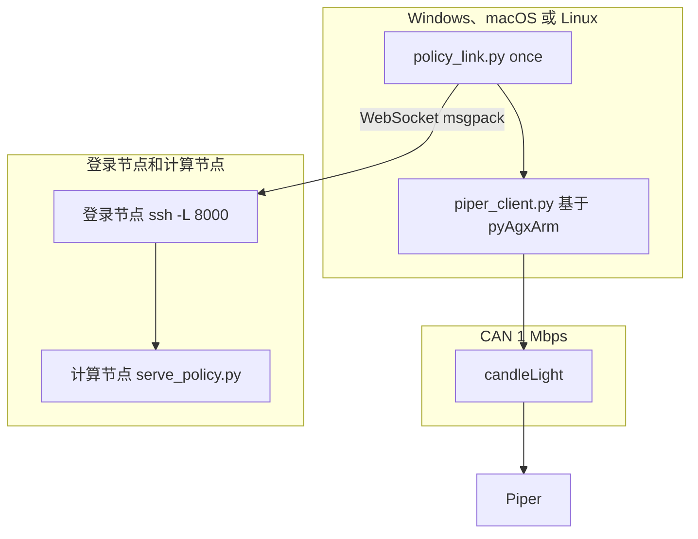

# 开发文档：Piper 客户端与策略链路

这份文档给要改代码或查协议的人。操作步骤在 `用户文档.md`。英文版是 `DEVELOPER_GUIDE.md`。



## 从这里找

| 要改或要查的内容 | 位置 |
| --- | --- |
| 只读状态、夹爪动作 | [piper_client.py](#piper_clientpy) |
| 各平台的 CAN 后端、固件配置 | [官方 SDK（pyAgxArm）](#官方-sdkpyagxarm) |
| 发给模型的字段 | [观测契约](#观测契约) |
| 模型返回后怎么变成末端指令 | [动作契约](#动作契约) |
| WebSocket 和超时 | [策略链路](#策略链路) |
| 设备打不开 | [设备占用](#设备占用) |
| CAN 帧格式和 ID | [协议](#协议) |
| 已经证明走不通的库 | [不要换的入口](#不要换的入口) |
| 还没做的功能 | [边界](#边界) |
| 拿到一个候选策略仓库 | [候选仓库核对](#候选仓库核对) |

## 仓库里用哪几个文件

| 文件 | 职责 |
| --- | --- |
| `piper_client.py` | `PiperClient`：官方 `pyAgxArm` SDK 外面的一层薄封装，单位是度和毫米。`read_state()`、`driver_faults()`、夹爪、退出示教、使能、MOVE J、MOVE P。见 [piper_client.py](#piper_clientpy) |
| `piper_can_bus.py` | 按平台选 CAN 后端和固件配置；在 Windows 和 macOS 上经 USB 直接驱动适配器。见 [官方 SDK（pyAgxArm）](#官方-sdkpyagxarm) |
| `policy_link.py` | 组观测、保持一条 WebSocket，循环推理。相机和 CAN 写不放在同一个进程 |
| `policy_step.py` | 把一段动作积成底座坐标下的末端轨迹并写到 CAN |
| `team_config.json` | 账号、策略配置名和 checkpoint。从 `team_config.example.json` 复制。其余键在 `DEFAULTS` 里按这套设备给了默认值，文件里的非空值会覆盖它。真实文件在 `.gitignore` 里，因为仓库是公开的 |
| `team_config.py` | `run` 提交作业、等待监听、打开一条本机转发并开始连续控制。`once` 在转发已开时再开始一轮。`down` 取消作业并关掉转发。`job` 和 `serve` 仍只打印命令 |
| `simple_policy_server.py` | 不带模型、测试链路用的脚本化策略服务器。见 [macOS 与简单服务器](#macos-与简单服务器) |
| `用户文档.md` | 操作步骤 |
| `_can_listen.py` | 只接收、不发送的抓包。日志写在本目录的 `_can_listen_log.txt` |
| `check_candidate_repo.py` | 拿到候选策略仓库后先检索配置、动作、归一化、相机和 Piper 执行代码 |
| `prepare_dataset.py` | 把成功的示教整理成 `datasets/piper_finetune`。服务器改动见 `服务器训练对接.md` |

路径都相对于这份代码所在的目录。不要在文档或新代码里写某个人的桌面绝对路径。服务器路径以 `team_config.json` 为准。

所有 CAN 通信都经过松灵的 `pyAgxArm`。旧的 `piper_sdk` 和 `piper_ros` 不使用，也不在这个仓库里。

## 官方 SDK（pyAgxArm）

`pyAgxArm` 是松灵目前的官方 Python SDK，支持 Piper 和 Nero。它打开总线只用 `python-can` 的 `can.interface.Bus(interface=..., channel=..., bitrate=...)` 这一处。官方针对各平台的路线：

| 平台 | 官方路线 | 对本仓库的 candleLight（gs_usb，`1D50:606F`） |
| --- | --- | --- |
| Linux | `socketcan`，`can0` | 能用 |
| Windows | `agx_cando`（`cando.dll`） | DLL 里没有这个适配器的 WinUSB GUID，大概是给松灵另一款模块的。未测试 |
| macOS | `slcan`，`/dev/ttyACM0` | 不能用：这个适配器不提供串口 |

`piper_can_bus.py` 补上缺口：它注册一个名为 `piper_usb` 的 `python-can` 接口，经 USB 直接驱动适配器（Windows 上用 ctypes 调 WinUSB，macOS 上用 pyusb 调 libusb），把 `can.Message` 和 20 字节 gs_usb 帧互相转换，并丢掉发送回显。pyAgxArm 的代码不改。

```python
from piper_can_bus import create_piper_arm
robot = create_piper_arm()   # Linux 且有 can0：socketcan；否则 piper_usb
robot.connect()
```

- `can_args()` 选接口和通道：`/sys/class/net/can0` 存在时用 `socketcan` / `can0`（`PIPER_CAN_INTERFACE` 可指定别的接口名），否则用 `piper_usb`。
- Linux 上接口关闭时（比如重新插拔后），`bring_up_can()` 把它设为 1 Mbps 并打开，需要 root。
- `create_piper_arm()` 的驱动配置依次取 `PIPER_FIRMWARE`、`firmware=`、`team_config.json` 的 `piper_firmware`；都没设（`auto`）时才向臂查询固件版本（只是查询，不动臂），再用 `resolve_firmware_profile()` 选配置。查询前先等反馈到达，因为在反馈频率测出来之前，`get_firmware()` 会丢掉收到的回复。
- `open_bus()` 在同一个适配器上返回一个普通的 `python-can` 总线，给 `_can_listen.py` 用。

pyAgxArm 有一个后台线程持续解析所有反馈帧，读取时立刻拿到最新值。它的单位是弧度和米，`PiperClient` 换算成度和毫米。

绝不调用 `calibrate_gripper()` 和 `calibrate_joint()`：它们发送 `0xAE`，会把当前位置写成零点。

已验证的部分：

- IQ9075（Linux，socketcan）：`read_state()`、`driver_faults()`、`gripper_max_mm()`、`team_config.py arm` 和 `_can_listen.py`（25 s 收到 58,026 帧，高速反馈每个 ID 约 200 Hz）。用 pyAgxArm 的 `enable()`、`set_speed_percent(20)` 和 `move_j` 让 J1 转 +10° 再转回，驱动器没有故障。固件 `S-V1.9-0` 对应配置 `v189`。
- macOS 接真实适配器：pyAgxArm 经 `piper_usb` 读到的关节、法兰位姿和固件与 IQ9075 上一致，反馈约 200 Hz。
- 离线用假适配器：`PiperClient` 发出退出示教 `0x150`（第 2 字节 `0x02`）、使能 `0x471`、经 `0x151` 切到 MOVE J、插值后的 `0x155`–`0x157`，以及设零字节为 `0x00` 的夹爪 `0x159`。
- 还没跑：经新 `PiperClient` 的 `ready`/`home` 和策略 chunk，以及 `piper_usb` 接真实的 Windows 适配器。

安装：`pip install python-can "git+https://github.com/agilexrobotics/pyAgxArm.git"`，macOS 上另外要 `pyusb` 和 `brew install libusb`。IQ9075 上没有 pip，把 `python-can`、`packaging`、`typing_extensions`、`wrapt`（aarch64）和 `pyAgxArm` 的 wheel 解压到 `.pylib`。那里的 Python 没有 `sqlite3`，而 `python-can` 会为一个本项目用不到的日志写入器导入它；在 `.pylib` 放一个占位的 `sqlite3.py` 即可。

## piper_client.py

`PiperClient` 是上下文管理器。`connect()` 调用 `create_piper_arm()`，启动 pyAgxArm 的线程，并初始化松灵夹爪 effector。`close()` 停掉线程、释放适配器；它不失能机械臂，臂会保持当前姿态。

`read_state(timeout=0.6)` 返回最新反馈，连接后最多等 `timeout` 让反馈到达。超过 0.5 s 没更新的反馈按缺失处理。下面每个字段都有时 `complete` 才为 True：

| 字段 | 来源 | 单位 |
| --- | --- | --- |
| `joints_deg` | `get_joint_angles()`（`0x2A5`–`0x2A7`） | 度 |
| `gripper_mm` | 夹爪 `get_gripper_status()`（`0x2A8`） | 毫米 |
| `gripper_effort` | 同上，力 | 0.001 N·m |
| `gripper_status` | 同上，状态字节 | 原始值 |
| `pose_mm_deg` | `get_flange_pose()`（`0x2A2`–`0x2A4`），`x y z rx ry rz` | 毫米和度 |
| `status` | `get_arm_status()`（`0x2A1`） | 见协议一节 |

状态名字（`TEACHING`、`CAN_CTRL` 等）取自 `piper_client.py` 里的表，不用 pyAgxArm 的名字，所以录好的 episode 和 `dataset_export.py` 里的字符串不变。

`driver_faults()` 读六个关节的 `get_driver_states()`，返回 `{关节: [故障名]}`；没有新反馈的关节报 `no feedback`。

`gripper_max_mm()` 向夹爪查询配置的行程（`get_gripper_teaching_pendant_param()`）。70 或 100 时采用，否则回退到 70。有一台臂回复 100。

`move_gripper(target_mm, effort=1000)` 只发夹爪命令，约每 10 ms 重发一次，直到反馈与目标相差 1 mm 以内或超过 4 秒。目标限制在 0–100 mm，力矩限制在 0–5000。它不使能关节，设零字节保持 0。

`exit_drag_teach()` 用 pyAgxArm 的 `0x150` 消息（第 2 字节 = `0x02`，结束拖动示教记录）连发五次。pyAgxArm 没有对应的公开接口，所以用了驱动的 `_send_msg`。它不是急停，也不写零点。`enable_arm()` 调用 `enable()`。

`move_joints(...)` 先按 `JOINT_LIMITS_DEG` 检查目标，用 `set_speed_percent()` 设速度，然后在 `duration` 内每 5 ms 调一次 `move_j`，目标从 `start_deg` 插值，每秒更新 `update_hz` 次。`move_pose(...)` 在 `duration` 内每 10 ms 调一次 `move_p`。两者都能在同一个循环里重发一个夹爪命令。

`0x2A1` 控制模式为 `0x02`（`TEACHING`）且示教字节为 `0x01` 时，末端位姿命令不会执行。低速反馈 `0x261`–`0x266` 第 6 字节的 bit 6 表示该关节驱动器已使能。

在 Windows 上，相机和 CAN 写放在同一个进程会以 access violation（`3221225477`）退出，所以机械臂放在单独的进程里。`policy_link.MotionWorker` 每次运行只启动一次 `policy_step.py worker`；这个进程只连一次机械臂，通过 stdin/stdout 上的 pickle 元组响应读状态和执行 chunk，打印走 stderr。`policy_link.py` 只保留相机：`PolicyCameras` 一次开着两台 D405，各有一个后台线程只保留最新一帧。以前每轮都要重开相机、连两次机械臂（每次都识别固件），还在最后一个目标上停 0.5 s，两个 chunk 之间停 1–3 s；现在只剩几十毫秒加推理时间。

## 策略链路

`policy_link.py` 使用和 `openpi_client` 相同的 WebSocket：连接后服务器先发一条 msgpack 元数据，之后每次观测一条 msgpack，回复也是一条 msgpack。NumPy 用 `__ndarray__` 字段传输，键为 bytes：`data`、`dtype`、`shape`。

服务器目录、账号、主机名和模型名只放在每个人自己的 `team_config.json`。缺字段时 `team_config.py` 会列出要填的键，不会套用别人的路径。操作员执行 `python team_config.py run`：它在登录节点提交或复用名为 `serve-policy` 的作业，等日志出现 `listening on`，用 `scontrol` 的 `NodeAddr` 从本机做一条 `ssh -L`，然后调用 `policy_link.py once`。Windows 上转发窗口留着；macOS 上转发在后台，`down` 用 `pkill` 关掉。`down` 取消该用户名下的 `serve-policy` 作业并结束本机对应的 `ssh -N`。`job` 和 `serve` 仍只打印文本，给需要手工启动的人。

`once` 的顺序：

1. 最多重试 50 次连接 `ws://host:port`，单次握手超时 2 秒。`python team_config.py once` 和未写 `--port` 的 `python policy_link.py once` 都使用 `local_forward_port`。`python policy_link.py serve` 仍默认监听 `127.0.0.1:8765`，那是本机占位服务。
2. 30 秒内接收元数据，打印 `server_connected`。
3. 向运动进程要 `read_state()`。不完整就抛错，不发送。
4. `PolicyCameras.read_bgr()` 返回调用之后从两台 D405 各拍到的一帧：`third_view` 和 `wrist`，按 `team_config.json` 里的序列号选设备。`model_image()` 把每帧转成 RGB 并填充到 224×224。`build_observation(state, image, wrist_image)` 把它们作为 `observation/image` 和 `observation/wrist_image` 发出。
5. 发送观测，打印一段证明"发出去的是什么"的信息：两路图像的形状、dtype 和均值，`third_vs_wrist_mad`（两路模型输入的逐像素平均绝对差，小于 1.0 说明两个槽装的是同一张图，也就是相机角色标反了），解码后的 16 维 state（`xyz_mm`、`quat_xyzw`、六个恒为 0 的机身维、拆成两指的夹爪开度）和 prompt。然后打印 `waiting_for_inference`。
6. 最多等 600 秒。回复若是字符串，原样作为 `RuntimeError` 抛出，这是 OpenPI 返回异常的方式。
7. 打印回来的 chunk：形状、dtype、`action_space`；`ee_delta` 时再打印累计平移（毫米）、累计转角（度）、夹爪均值、以及 7–11 列的最大绝对值。horizon 不对或整段全零会打成 `WARNING`，占位服务不会被误当成策略。一次已验证的返回是 `(50, 12)`。然后由运动进程执行整段，打印 `pose_sent` 和执行后立即读到的状态（不再等待停稳）。
8. 回到第 3 步。`Ctrl+C` 打印 `stopped` 并退出；运动进程也收到 Ctrl+C 并断开。WebSocket、相机和运动进程在整个循环里一直开着，只有运动进程打开适配器。

`--observe-only` 走完 1–7 但不执行第 7 步的整段动作，改为打印 `observe_only: chunk not applied; the arm has not moved`；`--cycles N` 在 N 次观测后停下，不用等 `Ctrl+C`。第一次真机 rollout 之前就用这两个开关验证：两路图像、16 维 state 和 prompt 确实到了服务器，服务器回来的 chunk 形状对，而且客户端这边没有任何东西在动臂。这条检查不依赖 checkpoint 是否正确，所以 chunk 离谱也说明传输是通的。

`python policy_link.py serve` 是本机占位服务，监听 `127.0.0.1:8765`。它只检查当前代码里的观测形状并返回占位动作，不能代替任何人的 checkpoint。

## 观测契约

图像张数、状态维度、提示词和动作含义都由所加载的模型决定，不是仓库里的固定标准。换模型时改 `build_observation()`，并让 `team_config.json` 的 `policy_config` 与 `checkpoint_dir` 指向那一份权重。

当前函数里的填法只是代码现在的样子，下表不是所有人的输入：

| 键 | 值 |
| --- | --- |
| `observation/image` | uint8，`(224, 224, 3)`，第三视角 D405 彩色帧，已经是 RGB |
| `observation/wrist_image` | uint8，`(224, 224, 3)`，腕部 D405 彩色帧，已经是 RGB |
| `observation/joints_deg` | float32，`(6,)`。脚本服务器用它发关节指令，模型服务器丢弃 |
| `observation/state` | float32，形状 `(16,)` |
| `prompt` | `PROMPT` 常量，当前是 `put the pen into the box`。必须和 `meta/tasks.jsonl` 逐字一致 |

两路图像。`pi05_piper_finetune` 把 `observation/image` 送进 `base_0_rgb`，把 `observation/wrist_image` 送进 `left_wrist_0_rgb`，只把 `right_wrist_0_rgb` 的 `image_mask` 设为假。脚本服务器会拒绝缺少腕部键的观测，所以相机半接好的问题在本机就暴露，不会拖到 GPU 节点上。

openpi checkout 自带的那份适配器并不宽松：`robocasa_policy.RobocasaInputs` 对任何 pi05 模型都直接抛 `observation/right_image is required for pi05 but not found in data`，因为它对应的 robocasa 数据集本来就是三路相机。`team_config.py patch-remote` 会把那个分支改成缺键时补零并屏蔽（和 DROID 适配器一致），键存在时照常使用 `right_wrist_0_rgb`。改写逻辑在 `openpi_patch.py`：按文本匹配那四行分支，输出 `patched` / `already_patched` / `no_match` / `missing`，第一次运行会把原文件留成 `robocasa_policy.py.orig`，写盘前先 `compile()` 校验语法。它用 `remote_python` 在登录节点上跑，不需要 venv；改完必须重启服务器，因为 `serve_policy.py` 在启动时就把 transform 建好了。

这 16 个数的顺序写在 `piper_train_state()` 里，和 `prepare_dataset.piper_train_state()` 逐位相同（有自检脚本核对过差值为 0）：

| 下标 | 内容 | 本客户端怎么填 |
| --- | --- | --- |
| 0–2 | 末端位置，米，机械臂底座系 | Piper 末端 `x y z` 毫米除以 1000 |
| 3–6 | 末端四元数 **xyzw** | `rx ry rz` 度先按 `R = Rz(rz) Ry(ry) Rx(rx)` 转矩阵，再转四元数并换成 xyzw |
| 7–12 | 静止底盘位置与四元数 | 严格填 0。这几维的 `std` 是 0，`(x-mean)/(std+1e-6)` 会把任何偏移放大 1e6 倍 |
| 13 | 底盘四元数 w | 1.0 |
| 14–15 | 两指关节位置，米 | 开口毫米数除以 2000，一正一负（22 mm 约 `0.011, -0.011`） |

不要改 msgpack 封装。图像必须是 RGB：`model_image()` 已经把 OpenCV 的 BGR 翻过来，服务器不会再翻。当前控制不使用相机外参，没有做手眼标定。

## 动作契约

`policy_step.py` 的 `action_waypoints()` 按下面的规则解释当前这段 12 维输出。这是已经对照过的一份末端增量策略，不是所有 checkpoint 的通用格式。换模型时替换这个函数，不要把 12 个数当成六个关节角写入 `0x155`。

| 下标 | 含义 | 本客户端怎么用 |
| --- | --- | --- |
| 0–2 | 末端平移，底座坐标，控制器单位约在 [-1, 1] | 乘 0.05 m，再乘 1000 得到毫米，加到当前 `x y z`。+X 向前，+Y 向左，+Z 向上 |
| 3–5 | 轴角，同一底座坐标，控制器单位约在 [-1, 1] | 乘 0.5 rad，左乘到当前姿态。欧拉角与 `piper_fk` 一致：`R = Rz(rz) Ry(ry) Rx(rx)` |
| 6 | 夹爪 | 大于等于 0.5 视为闭合，目标 0 mm；否则张开到 `gripper_max_mm()` |
| 7–10 | 底盘与升降 | 这台 Piper 没有这些机构，丢掉 |
| 11 | 控制模式 | 不是长度，丢掉 |

`team_config.json` 的 `execute_steps` 只保留每个 chunk 的前 N 步（空着则全部执行），`ee_delta_scale` 缩放平移和旋转（空着则为 1）。发送前 `check_limits()` 拒绝离起点超过 `max_chunk_shift_mm` 的 chunk，一帧都不发。保留下来的每一步按 0.05 秒、速度 50% 发送。一段走完后，`policy_link.py` 用新的图像和状态再要一段。已验证：退出示教后，一段的终点位姿能被手臂跟上，`motion=0`。

## macOS 与简单服务器

在 Windows 和 macOS 上，`piper_can_bus.py` 经 USB 驱动 candleLight：Windows 用 `_WinUsbTransport`（ctypes，重叠 I/O），macOS 用 `_LibUsbTransport`（pyusb，VID `1D50` / PID `606F`）。`open_transport()` 对两者发送同样的 gs_usb 控制传输，在 48 MHz 时钟下把总线启动到 1 Mbps。关闭时不发总线停止控制传输，它会让进程挂起。

libusb 传输层用后台线程持续读 IN 端点，放进 256 帧的队列（约 0.1 s 反馈，满了丢最旧的）。不这样做的话，约 2700 帧/s 的反馈会耗尽适配器的帧缓冲，十几帧之后 OUT 写入就以 errno 60 超时。这也是不用 python-can 自带 `gs_usb` 后端的原因。Windows 上读写共用一个 WinUSB 句柄和缓冲，所以 `PiperUsbBus` 用一把锁让它们串行。

Mac 上的准备：

```bash
brew install libusb
python3 -m venv .venv
.venv/bin/pip install numpy msgpack 'websockets>=13' opencv-python pyobjc-framework-AVFoundation pyusb pandas pyarrow python-can "git+https://github.com/agilexrobotics/pyAgxArm.git"
```

macOS 上相机走 OpenCV 的 AVFoundation 后端，不走 `pyrealsense2`。pip 上的 `pyrealsense2-macosx`（2.56.5）在 macOS 27 上报 `failed to set power state` 后段错误，加 `sudo` 也一样。Homebrew 的 librealsense 2.59.1 能认出两台相机，但只在 `sudo` 下可以，而且不带 Python 绑定。AVFoundation 后端不需要 `sudo`，只要给运行 Python 的应用开相机权限（系统设置 → 隐私与安全性 → 相机）。做法（`policy_cameras.py`）：

- `team_config.json` 的 `camera_backend`：空着时 macOS 上用 `avfoundation`，其它平台用 `realsense`；写 `"realsense"` 或 `"avfoundation"` 则强制使用。
- AVFoundation 只按唯一 ID 认相机，格式是 `0x` + USB `locationID` + `80860b5b`（Intel、D405）。配置里的 RealSense 序列号先经 `camera_usb_serials` 换成相机的 USB 序列号（默认值就是这套设备的两组；新相机的这一组用 `sudo rs-enumerate-devices` 查，分别是 "Serial Number" 和 "Asic Serial Number"），再经 `ioreg` 换成 `locationID`，最后换成 OpenCV 编号。OpenCV 把所有 AVFoundation 视频和 muxed 设备（包括内置、iPhone 和虚拟相机）按唯一 ID 排序后编号，所以 `_avfoundation_unique_ids()` 通过 pyobjc 做同样的调用。
- 角色也可以指向普通 USB 摄像头而不是 D405，只限这个后端：把 `third_view_serial`（或 `wrist_serial`）设成 `uvc:` 加它的 USB 厂商号和产品号，也就是唯一 ID 的末尾，比如 Logitech C930e 是 `uvc:046d0843`。它没有能看到的序列号，所以同型号插两台会被拒绝；USB ID 已经对上，所以跳过 1280×720 检查。画面走同样的 4:3 居中裁剪再缩到 640×480，1920×1080 的摄像头左右各裁掉 240 像素。换第三视角相机等于换了视角：要重新录示教，不要和旧相机录的数据混在一起。
- `team_config.json` 里的 `third_view_camera` / `wrist_camera` 选牌子：`logitech`、`orbbec`，`d405` 或留空表示用这个角色的序列号（`CAMERA_BRANDS`）。`third_view_controls` / `wrist_controls`（比如 `{"focus": 30, "white_balance": 3500}`）在每次打开相机时固定摄像头的对焦和白平衡，并记到 episode 的 `camera_controls`。AVFoundation 没有摄像头白平衡控制，libusb 又被拒绝，所以 `uvc_controls.py` 用 ctypes 经 IOKit 发 UVC 控制请求：不需要 sudo，也不用编译。它假定 camera terminal 是 1、processing unit 是 3，只在 Logitech C930e 上试过；这台相机把对焦 34 存成 30，所以要选读回来不变的值。曝光仍是自动。
- 打开的相机必须出 1280x720，否则判定为打开了错的设备并报错。画面居中裁成 4:3 再缩放到 640x480，形状和 RealSense 那条路一致（`prepare_dataset.py` 要求尺寸统一），但视野可能和 SDK 的 640x480 模式略有不同。每条录制在 `metadata.json` 里记下 `camera_backend`。
- 没有深度：`depth_profile_mm()` 返回 None。角色照旧用 `_realsense_test.py` 和 `cameras --motion-check` 验证。

只有 `demo.py` 写视频（`collect.py`、`episode_recorder.py` 和 `policy_link.py replay` 都不写），通过 `PacedVideo`，它按真实时间重复或跳过帧，所以 mp4 的播放速度和实际一致（优先 H.264 `avc1`，不行用 `mp4v`）。录完一条后它调用 `episode_recorder.write_episode_video()`，用存下的 JPEG 生成 `recording.mp4`，一帧都没写出或 `image_timestamps.parquet` 为空时返回 None；每次回放传 `replay_episode(..., video_path=...)`，把回放窗口写成 `replay_*.mp4`。视频写入失败时 `_with_camera_window()` 只关掉视频，回放继续。

`policy_cameras.py` 按序列号选相机，因为两台 D405 是同型号，OpenCV 编号或 V4L2 节点在不同次运行之间可能指到另一台。只有 `realsense` 后端（Linux、Windows）要装 `pyrealsense2`；macOS 的 AVFoundation 后端改装 `pyobjc-framework-AVFoundation`。`third_view_serial` 和 `wrist_serial` 默认就是这套设备上的两台 D405，只在要换相机时才写进 `team_config.json`。`camera_serials()` 把它们和 `realsense_devices()` 对一遍（它列出 `rs.context().query_devices()`，macOS 上则是 AVFoundation/`ioreg` 扫描结果经 `camera_usb_serials` 映射回的序列号，没映射的显示为 `usb:<序列号>`），序列号没插上或两台填成同一个都直接报错。

**深度不能用来认相机。** 两台 D405 挂在同一个集线器上时互相干扰深度读数，而且中位数取决于那台相机碰巧对着哪里，所以早先按"深度中位数更小的是腕部"来分配的做法把两路标反过。角色现在只来自 `team_config.json`，`python policy_link.py cameras` 只把深度分布当参考打印，不再据此下结论。要确认真实归属，用下面两种之一：

- `python _realsense_test.py` 往 `_camera_test/` 写 `third_view.png`、`wrist.png` 和 `side_by_side.png`，每张图上标着自己被分配的角色和序列号，另有 224×224 的模型输入。第三视角是架在臂外的固定相机，腕部视角是固定在臂上的那台。
- `python policy_link.py cameras --motion-check` 先各拍一张，然后请你动一下臂再按回车，报告哪台的画面变了。跟着臂动的那台就是腕部视角；和 `team_config.json` 不一致时会给出警告。它自己不发任何运动命令。

如果是反的，把 `third_view_serial` 和 `wrist_serial` 对调即可，没有别的地方读这两个序列号。`python policy_link.py preview` 给每台相机各开一个窗口，标题带角色和序列号，左上角是 224×224 的模型输入，按 q 关闭。运行命令的 App 需要相机权限。

`policy_step.check_limits()` 在发送任何帧之前运行。只要某个 waypoint 离本 chunk 开始前读到的位姿超过 `max_chunk_shift_mm`（默认 30），或者落在基座系绝对盒子 `workspace_mm`（`{"x": [min, max], ...}`，空的轴跳过）之外，就 raise，一帧都不发。

`simple_policy_server.py` 按 `action_waypoints()` 的动作含义返回脚本化的 `(50, 12)` chunk：沿 +X 走 10 mm 再回来，夹爪每个 chunk 交替开合。`server_mode` 为 `"simple"` 时，`team_config.py setup-remote` 把它和 `policy_link.py`、`policy_cameras.py`、`piper_client.py` 拷到 `remote_code_dir` 并在那里建 venv；`run` 随后不申请 GPU 提交它。`"openpi"` 仍走 `serve_policy.py`。非 Windows 上本地转发是后台的 `ssh -f -N -L`，`down` 用 `pkill` 关掉。

## Linux 与 IQ9075

已在 Qualcomm IQ9075（aarch64 Yocto，Python 3.12）上验证，机械臂和 Astra Pro 直接插在它上面。那台设备跑的是旧的单相机代码；当前代码要求两台 RealSense D405。

- CAN：Linux 内核的 gs_usb 驱动把适配器占成 `can0`，pyAgxArm 在上面用 python-can 的 `socketcan` 后端。重新插拔后由 `bring_up_can()` 把 `can0` 以 1 Mbps 打开，需要 root。
- 相机：只有 `pyrealsense2` 一个后端，按序列号选设备，所以 Linux 上不需要映射 `/dev/videoN`。把两个序列号按上面的说明填进 `team_config.json`。
- 那里的 Python 没有 pip、`ensurepip`、`venv` 和 `sqlite3`。在别的机器上下载 `manylinux` aarch64 cp312 的 wheel（`pip download --only-binary=:all: --platform manylinux2014_aarch64 --python-version 3.12 ...`），解压到代码目录下的 `.pylib`，运行时加 `PYTHONPATH=.pylib`。`sqlite3` 占位模块见 [官方 SDK（pyAgxArm）](#官方-sdkpyagxarm)。

驱动器故障：把关节顶到机械限位会触发过流，那个关节的驱动器随之失能；之后控制器忽略所有关节命令，只有夹爪还能动。`PiperClient.driver_faults()` 读 `0x261`–`0x266` 的第 5 字节，有故障时 `policy_step.require_healthy_drivers()` 拒绝发送任何运动帧。断电重启机械臂才能清除。

`policy_link.py home` 去 `team_config.json` 的 `home_deg`，没有就用 `HOME_DEG`（J2 10°、J3 −5°），即折叠休息位稍上方。全 0 曾在一台臂上把 J2 顶到限位并触发上面的故障。每台臂按现场读到的休息位设 `home_deg`，每个关节离限位留一点余量。

## 关节空间动作

从折叠的休息位姿发末端位姿（MOVE P）目标，会被机械臂自己的逆解拒绝：状态显示 `TARGET_EXCEEDS_LIMIT`，只有夹爪会动。所以回复里可以带 `"action_space": "joints"`，动作为 `(N, 7)`：六个绝对关节角（度）加夹爪闭合程度（0 为完全张开到 `gripper_max_mm()`，1 为 0 mm，中间值为部分闭合）。`policy_link.py` 把动作空间传给运动进程；回复里没有这个字段时按 `ee_delta` 处理。

`apply_joint_actions()` 发 MOVE J（`0x151` 第 1 字节 = `0x01`），关节角走 `0x155`（J1、J2）、`0x156`（J3、J4）、`0x157`（J5、J6），大端 int32，单位 0.001 度，每步 0.05 s，速度为 `joint_speed`（默认 60%）。每一步内部 `move_joints(start_deg=...)` 从上一个目标插值，约每 5–7 ms 重发一次（约 140 Hz）。MOVE J 对每个新目标都重新规划，所以每 0.05 s 只换一次目标时，J1、J2 每一步都会起停、一卡一卡；速度 30% 时机械臂还跟不上指令的速度。发送前 `check_joint_chunk()` 会拒绝任一步让某个关节变化超过 3 度的 chunk，也拒绝离起点超过 `max_chunk_joint_deg`（默认 100）的 chunk。`move_joints()` 拒绝超出 `JOINT_LIMITS_DEG` 2 度以上的目标，小于 2 度的截到限位。observation 里带有 `observation/joints_deg`，供脚本化服务器使用。

`simple_policy_server.py --mode demo`（默认）先以半速展开到 `READY_DEG = [0, 45, -45, 0, 30, 0]`，然后轮流做：J1 挥手（±30）、J5 点头加 J2/J3 前伸、J6 ±90 转腕并开合夹爪。每段的步数按距离调整，保证任一关节每步不超过 2.4 度。`--mode nudge` 保留原来的末端位移测试。

低速反馈 `0x261`–`0x266` 里，驱动使能标志是第 5 字节（从 0 数）的 bit 6。

## 回放与服务器模式

回放用 `episode_recorder.py` 录的拖动示教（见 `数据采集.md`）。`episode_arrays()` 从 `robot_feedback.parquet` 读 `j1_deg`–`j6_deg`、`gripper_mm`、`t_robot`，也能从 `.npz` 读同样的数组。`setup-remote` 用 `write_replay_npz()` 写出这个 `.npz`，上传为 `episodes/<episode 文件夹名>.npz`，服务器的 venv 不需要 pandas。录制脚本在 Windows 和 macOS 上都能跑：`PolicyCameras` 整段录制期间一直开着两条 D405 管线，`KeyReader` 通过 `msvcrt` 或 cbreak 模式的终端读 `s`/`f`/`d`（退出时恢复；macOS 之后会置上 `PENDIN`，无害）。

`episode_recorder.py --leader`（以及 `collect.py --leader`）录主从遥操作：这台臂跟随同一条 CAN 总线、同一个适配器上的主臂。它不移到 `READY_DEG`（关节指令会和主臂打架），也不发送任何帧。`PiperClient.leader_command()` 读主臂广播的关节指令（`0x155`–`0x157`，经 pyAgxArm 的 `get_leader_joint_angles()`；它把缺的帧填 0，所以自己检查 parser 里 `leader_joint_12/34/56` 的时间戳）和夹爪指令（`0x159`），超过 0.5 s 算缺失。每行反馈加 `lead_j1_deg`–`lead_j6_deg` 和 `lead_gripper_mm`（缺失为 NaN，次数记在 `leader_missing`），metadata 写 `collection_mode: leader_follower`。这些列不导出：标签仍取从臂的实测位姿。`dataset_export.demonstrating()` 决定哪些样本算示教：`drag` 要 `TEACHING` 且 teach=1，`leader_follower` 要控制模式在 `FOLLOWING_MODES` 里（只有 `CAN_CTRL`：在这台臂上实测，从臂跟随时 `0x2A1` 一直是 `CAN_CTRL`、MOVE J、teach 0）；其余样本标 `not_teaching` 或 `not_following`，mask 为 0。`episode_check.py` 把这个比例打印为 `teaching_fraction`，并在 `mode_changes` 里列出出现过的模式。总线上主臂发 `0x151`、`0x155`–`0x157`、`0x159`、`0x190`、`0x471` 和 `0x476`，约 20–70 Hz。两台臂都会回答固件查询（`get_firmware()`），多帧回复每次都交错成读不出的版本号（`'MC\x00\x00ARM_'`）；`create_piper_arm()` 重试八次。交错的回复不再去猜：原始帧是同一份混合，第一个 `S-V` 可能属于主臂，所以直接要求设置 `PIPER_FIRMWARE`。`_firmware_from_raw_bus()` 只在单臂回答、但 SDK 什么都没返回时才按帧再读一次。这个环境变量（`default` 对应 S-V1.8-2 及以下，`v183` 对应 S-V1.8-3 到 1.8-7，`v188`，`v189` 对应 S-V1.8-9 及以上）跳过查询。没设这个变量时，`create_piper_arm()` 自己从 `team_config.json` 读 `piper_firmware`（默认 `v189`），所以直接运行 `demo.py`、`collect.py`、`policy_link.py` 也会跳过查询，不只是经 `team_config.py` 启动的命令。

主臂刷了 2.0.7 固件以后，不再发 `0x155`–`0x157` 和 `0x159`：`0x1C0`–`0x1C3`（约 20–40 Hz）也不能说明主臂在线：主臂断电、从臂不再跟随后它们还在总线上，拖动示教时期的抓包里也有。要判断主臂是否在线，用手掰一下主臂，看从臂跟不跟。本仓库不解释这些帧，所以在这版固件下 `leader_command()` 返回 None，`lead_*` 列都是 NaN。别的都不依赖它们：导出门禁看的是从臂自己有没有动，`demo.py` 回放前要操作者确认主臂已断电。

`dataset_export` 按**从臂自身的运动**判断一条录制算不算示教，从不读主臂数据。`follower_motion()` 把导出网格上的末端路程加起来，再加总转角（用旋转矩阵算，避免欧拉角回绕把角度放大）；整条录制的路程小于 `MIN_PATH_MM`（10 mm）**且**转角小于 `MIN_ROTATION_DEG`（5°）就整条拒绝。没收到指令的从臂完全不动，拖动示教忘了开 teach 时也一样，一条规则同时覆盖这两种失败。这些数值写进 `export_metadata.json` 的 `follower_motion`，`episode_check.py` 在录制现场就会打印。

`lead_*` 列只用于诊断：`episode_check.py` 会打印 `leader_missing_share`，导出元数据里也记一份，这样你能区分"主臂没说话"和"臂根本没被拖动"，但它不参与任何判断，也不做标签。现在即使录制里连 `lead_*` 列都没有，只要从臂真的动了，`leader_follower` 也能照常导出（`--self-check` 两种情况都覆盖了）。

一条录制写 `images/NNNNNN.jpg`（第三视角）和 `images_wrist/NNNNNN.jpg`（腕部），两边用同一个编号，`image_timestamps.parquet` 每对帧一行，含 `file` 和 `wrist_file`。第三视角的路径和单相机时完全一样，所以旧 episode 仍然能读：没有 `wrist_file` 列就当作单相机录制，导出时 `wrist_image_index` 写 -1。`prepare_dataset.collect_segments()` 会跳过 grid 里没有腕部图像的录制，所以重建数据集时腕部相机之前的 episode 会被丢掉；如果一条都不剩，报错里会写明跳过了多少条。录制脚本把 JPEG 写盘放到线程里：在 `episodes/` 所在的 exFAT 上写一对帧要 30 ms 左右，光这一项就会把循环压到 15 Hz；循环按 `CAPTURE_DT_S = 0.05` 定节拍，一对帧正好落在导出的每一行网格上。

`pointing.py` 为指三条实验包了一层主从录制。`record_human_demo()` 按 episode 的图像布局（`images/`、`images_wrist/`，以及含 `file` 和 `wrist_file` 的 `image_timestamps.parquet`，但没有 `robot_feedback.parquet`）把人的部分写到 `--out` 下的 `_human_demo_*` 暂存文件夹，等 `record_episode(leader=True)` 返回后再移进 episode，成为 `human_demo/`。`human_demo` 不参与训练：`prepare_dataset` 只读 `--out` 下面直接一层的 `episode_*` 文件夹，所以暂存文件夹和嵌套的文件夹都不会被打包。数据集经 `finish_episode(episode, out, dest)` 重建到 `--dataset`（默认 `datasets/pointing`），它把 `dest` 传给 `build_dataset()`；`dest=None` 时仍是 `datasets/piper_finetune`，其他调用方不变。`wait_ready()` 在按 SPACE 时读一次臂（`arm_answers()`，只读，读完释放适配器），因为适配器脱离总线时从臂仍跟随主臂，画面看着正常，录下来却没有反馈。`infer` 的 prompt 来自 `--task`，做法是在 `infer_once()` 之前设置 `policy_link.PROMPT`，因为 `build_observation()` 读的是这个全局变量。

`simple_policy_server.py --mode replay --episode FILE` 用 `np.interp` 重采样到 0.05 s 一步，夹爪目标取录制宽度减行程的 `GRIPPER_SQUEEZE_FRACTION`（10%），录制宽度超过行程的 `GRIPPER_FULL_OPEN_FRACTION`（75%）时完全张开（夹东西时夹爪停在物体上，笔约 11 mm，按这个宽度回放只会贴着，目标再往里才会持续夹紧；以前按最大开度 30% 判开合的规则漏掉了只张开 35/56 mm 的松手）。`policy_link.py replay` 向运动进程要夹爪行程（`gripper_max_mm()`，70 或 100 mm；夹爪没回复时，70 mm 的默认值在整个连接期间缓存）。服务器用 `--gripper-stroke-mm`（默认 `GRIPPER_STROKE_MM`，70 mm），`team_config.py` 在 replay 模式下从 `gripper_stroke_mm`（默认 70）传入；100 mm 夹爪要设成 100，否则服务器的目标比本机回放的宽。另外把目标截到 `JOINT_LIMITS_DEG` 以内（手可以把 J5 拖过 70 度，此时打印 `clamped N steps`），超过 2.4 度的步会被拆开。每次回复下一段 `--chunk` 步（默认 50）。机械臂离这段第一行超过 2.4 度时（第一个 chunk、循环重来或跟踪滞后），前面加一段半速的 `keyframe_chunk()` 过渡。播完回复 `{"actions": (0, 7), "done": True}`，`policy_link.py` 打印 `server_done` 后返回；加 `--loop` 则从头再来。每个连接都从头回放。`policy_link.py replay [EPISODE]` 不用服务器做同样的事（相机只用于预览窗口；macOS 只能在主线程画窗口，所以 `_with_camera_window()` 把回放放进子线程）：`replay_episode()` 把 `Replay.next_chunk()` 交给运动进程，直到没有剩余；第一个 chunk 的 bridge 就是慢慢移到录制第一帧。后面的 chunk 用 `Replay(continuous=True)`，并传 `follows`（上一个发出的目标）：全速时臂比目标落后约 2 度，所以 `apply_joint_actions()` 从这个目标算 3 度单步限制，臂离它超过 `MAX_TRACKING_LAG_DEG`（6 度）就拒绝这个 chunk。不这样做的话，每个 chunk 交界都会多一段 1.5 s 的 bridge。服务器路径有推理间隔，保留原来的 bridge。它不经过 `READY_DEG`：`pointing.py` 和 `demo.py` 的录制从休息位开始，绕一趟会多出录制里没有的抬臂和夹爪张开。`episode_recorder.py` 每次录制前先移到 `READY_DEG`（运动进程在录制打开适配器前退出），所以回放和录制从同一个位置开始。

`team_config.py` 的 `--server simple|replay|openpi` 覆盖 `server_mode`，再套用 `mode_overrides[mode]`（任意键，通常是 Slurm 的分区、内存、时长）。`replay` 模式下 `setup-remote` 会把 `replay_episode` 拷到 `remote_code_dir/episodes/`。`openpi` 在 GPU 上运行 `openpi_python`（默认是 `openpi_dir` 里的 `.venv/bin/python`）；`openpi_dir`、`openpi_python`、`checkpoint_dir` 都可以用 `~/` 开头。任务带 `--comment=MODE`；`up` 不会复用另一种模式起的 `serve-policy` 任务。任务地址和 `piper_link_state.json` 里存的不一样时，`up` 会关掉旧的本地转发再开新的。

`apply_actions()` 只保留前 `execute_steps` 行（空则全部），并把 `ee_delta_scale`（空则 1.0）传给 `action_waypoints()`，平移和旋转都乘上它。限位检查抛 `ChunkRefused`；运动进程打印 `chunk_refused` 并回复 `refused`，`policy_link.py` 并重新观测，不再停掉循环。RoboCasa pi0.5 checkpoint 第一次调用约 30 s，之后每次约 0.15 s；不缩放时一个 chunk 积分出来是 0.3–1.5 m。

`policy_link.py home` 走同一个 `go_to()`，收回到 `HOME_DEG`（全 0，即休息位）。`policy_link.py ready` 和 `once --ready` 在跑 `ee_delta` 模型之前用关节目标展开到 `READY_DEG`，因为从折叠姿态发末端位姿目标会被拒绝。


适配器是 candleLight，`VID_1D50` / `PID_606F`，CAN 时钟 48 MHz。Windows 上它是 WinUSB，接口 GUID `{c15b4308-04d3-11e6-b3ea-6057189e6443}`。macOS 上用 libusb 打开同一个 VID/PID。

会让 `CreateFile` 返回错误 5 的来源：

1. ArmRobotUA。它用 `cando.dll` 独占设备，没有外部 SDK 或 ROS 端口。关掉程序后，非管理员进程可以打开同一接口。
2. `VMUSBArbService`。排查时曾把它停掉。虚拟机需要 USB 时再手动启动。
3. 上一次卡在驱动里的 Python 进程。关掉那个进程，仍失败时拔插 candleLight。

打开参数必须包含 `FILE_FLAG_OVERLAPPED`（`0x40000000`）。否则 `WinUsb_Initialize` 返回错误 6。读写使用 `OVERLAPPED`，997 表示 I/O 尚未完成。本机批量管道是 IN `0x81`、OUT `0x02`，换适配器时用 `WinUsb_QueryPipe` 再确认。

## 协议

发给适配器的 USB 控制传输和发给 Piper 的 CAN 帧不是一类数据。

控制传输：主机字节序请求 0，载荷 `0x0000BEEF`；位定时请求 1；启动请求 2 且 mode 为 1。48 MHz、1 Mbps 的定时是 `prop_seg=1, phase_seg1=12, phase_seg2=2, sjw=1, brp=3`。80 MHz 才用 `brp=5`。

gs_usb 帧 20 字节，无硬件时间戳：

```text
0   echo_id  uint32 小端
4   can_id   uint32 小端
8   dlc
12  data     最多 8 字节
```

`echo_id == 0xFFFFFFFF` 才是总线上收到的帧。`echo_id == 0` 是本机发送回显，不是臂的回复。标准 ID 取 `can_id & 0x7FF`。错误帧标志是 `0x20000000`，客户端会丢掉。

正常播报时大约：

| ID | 频率 | 内容 |
| --- | --- | --- |
| `0x2A1` | 约 190 Hz | 控制模式、臂状态、运动模式、示教、运动状态、轨迹号、故障码 uint16 大端 |
| `0x2A2`–`0x2A4` | 约 190 Hz | 末端 XYZ、姿态 |
| `0x2A5`–`0x2A7` | 约 190 Hz | 六个关节 |
| `0x2A8` | 约 190 Hz | 夹爪行程、力矩、状态 |
| `0x251`–`0x256` | 约 95 Hz | 驱动器高速反馈 |
| `0x261`–`0x266` | 约 19 Hz | 驱动器低速反馈 |

本机一次 `0x2A1` 原始字节是 `01 00 01 02 00 00 00 00`：CAN 控制、正常、MOVE_J、示教状态 2、运动状态 0、故障码 0。枚举在 `piper_sdk/.../arm_feedback_status.py`。

`0x710` 在早期短监听里出现过，25 秒被动监听里没有。没有可靠含义，不要回复。`0x1C0`–`0x1C3` 和 `0x212` 也出现过，客户端不解释它们。

固件查询是 `0x4AF`，数据 `01 00 00 00 00 00 00 00`。把接收载荷拼起来找 ASCII `S-V`。版本以现场读到的字符串为准。有这份回复只说明控制器在总线上，不等于周期反馈已经在发。

夹爪指令 `0x159` 的 8 字节为大端：int32 行程（0.001 mm）、uint16 力矩（0.001 N·m）、uint8 使能码、uint8 设零。设零字节必须是 `0x00`。`0xAE` 会把当前位置写成零点，禁止发送。使能码使用 `0x01`。不要为了周期反馈去猜 `0x477` 的第 3 字节，SDK 里两处说明互相矛盾。

## 不要换的入口

| 入口 | 结果 |
| --- | --- |
| `C_PiperInterface_V2("can0")` | 只适用于 Linux socketcan |
| `python-can` 自带的 `gs_usb` | Windows 上对本机 WinUSB 设备权限不足；macOS 上没有排空线程会卡住 |
| `pyAgxArm` + `agx_cando` | 官方 Windows 路线，没用这个适配器测过。由 `piper_can_bus.py` 提供的 `piper_usb` 代替 |
| `piper_ros` | Linux `can0` |
| ArmRobot 的界面或它内部的 `QTcpSocket` | 不监听外部端口，并独占适配器 |

## 候选仓库核对

拿到候选仓库后，先运行核对，再讨论怎么映射到 Piper。把仓库路径换成实际目录：

```powershell
python check_candidate_repo.py 仓库路径
```

程序会按下面五项检索线索，并给出文件和行号。它不能代替阅读。每一项都要写成确定结论后，才允许改 `build_observation()` 或发送关节指令。

1. 配置：单臂还是双臂，输入状态和输出动作各多少维。
2. 动作：关节角还是末端位姿，绝对值还是增量，单位是什么。
3. 预处理与后处理：是否包含训练时使用的归一化统计量或处理器文件。
4. 相机：需要哪些视角、字段名、分辨率。
5. 部署代码：是否有对应 Piper 驱动、夹爪映射和执行频率的实现。

这五项里只要动作类型、单位或相机字段仍不确定，就不要把检索到的数组直接写入 `0x155` 或 `0x159`。先改 `action_waypoints()`。

## 边界

已经在一套 Piper 和 candleLight 上验证的是：被动收齐 `0x2A1`–`0x2A8`，夹爪全行程开合且关节不变，WebSocket 能把观测送到策略服务并拿回 `(50, 12)`，退出示教后一段末端轨迹能被跟随。

已经接上两台 RealSense D405 彩色相机：第三视角和装在臂上的腕部。两帧都进入观测，都填充到 224×224。连续控制是外层循环：整段执行完，再观测，再推理。还没有做的是：右侧腕部相机、手眼标定、把 16 维状态和训练时的拼接逐项核对、关节空间 `0x155` 指令、主从偏移。当前这条链路不消费相机外参。换一份动作含义不同的模型时，先改 `action_waypoints()`。
