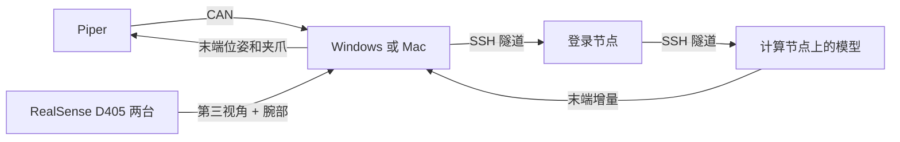

# 用户文档：把 Piper 的状态发给策略服务

这份文档给要操作的人。改代码、改观测字段或查 CAN 协议时看 `开发文档.md`。英文版是 `USER_GUIDE.md`。

当前能做的事：一台 Windows 或 Mac 读出机械臂状态，用两台 Intel RealSense D405（第三视角和腕部）各拍一张彩色图，把这两帧作为观测图像，经本机 SSH 隧道发给策略服务。服务每次返回一段末端增量。本机按底座坐标发出去，然后重新读取状态和图像，再要下一段，直到按 `Ctrl+C`。两台相机按序列号区分，不按 OpenCV 编号；序列号、固件、集群和目录布局是 `team_config.py` 里这套设备的默认值。`team_config.json` 只写账号、策略配置名和 checkpoint。Mac 上把下面的 `python` 换成 `.venv/bin/python`。



## 从这里找

| 你要做的事 | 去哪一节 |
| --- | --- |
| 第一次把整条链路跑起来 | [跑一次](#跑一次) |
| 确认机械臂在线，但不要让它动 | [跑一次](#跑一次) 里的 `arm` |
| 看某次输出算不算成功 | [怎样算通过](#怎样算通过) |
| 屏幕上的数字是什么意思 | [打印出来的内容](#打印出来的内容) |
| 报错了 | [出问题先看这里](#出问题先看这里) |
| 暂停这一次，或结束服务器 | [停掉这次测试](#停掉这次测试) |
| 用人拖动机械臂，录一条示教 | [录一条示教](#录一条示教) |
| 用完后给机械臂断电 | [用完以后](#用完以后) |

## 开始前

- Windows 上先关掉 ArmRobot。它开着时，本机打不开 CAN 适配器。
- 机械臂已上电，CAN 线插在臂的 CAN 口。
- 下面的命令都在本文件夹里执行。本文件夹是你解压或打开的这份代码所在的目录，不是某一个人的桌面路径。Windows 用 `python`，Mac 用 `.venv/bin/python`。
- 把 `team_config.example.json` 复制成 `team_config.json`，填写 `remote_user`、`policy_config` 和 `checkpoint_dir`。这个文件在 `.gitignore` 里，因为仓库是公开的。写进文件里的其他键会覆盖对应默认值；不写就用默认值。
- 登录节点是 `athena.egr.duke.edu`。只有 `.ssh\config` 里已经有对应 Host 时才设置 `ssh_host`。日志在 `~/logs`，代码在 `~/skipconnect-pi05-robocasa/third_party/openpi`。

## 在 Mac 上

先按开发文档做一次性准备（`brew install libusb` 和 `.venv`，其中包括 `python-can` 和 `pyAgxArm`），下面的 `python` 都换成 `.venv/bin/python`。第一次运行前：

1. 给终端开相机权限（系统设置 → 隐私与安全性 → 相机）。这套设备的 `third_view_serial` 和 `wrist_serial` 已经是默认值。录第一条之前先确认两路没标反：`python _realsense_test.py` 会往 `_camera_test/` 写带角色和序列号的图，`policy_link.py cameras --motion-check` 会让你动一下臂再告诉你哪台跟着动（跟着动的那台是腕部视角）。`policy_link.py preview` 实时显示两路画面，按 q 关闭窗口。
2. `server_mode` 为 `"simple"` 时，先填好 `slurm_partition`，再运行一次 `.venv/bin/python team_config.py setup-remote`，把测试服务器拷到 athena。
3. 机械臂周围留出空间。测试服务器每个 chunk 让末端沿 +X 走 10 mm 再回来，并开或合夹爪。离起点超过 `max_chunk_shift_mm` 的 chunk 会在发送前被拒绝。

本地转发在后台运行，不会弹出 `piper-link` 窗口。`down` 会关掉它。

关节空间的 chunk（demo 服务器）有两个参数可以调平滑度，方便多跑几次对比；`team_config.py once` 和 `run` 也接受这两个参数：

```bash
.venv/bin/python policy_link.py once --port 8000 --freq 100 --speed 60
```

`--freq` 是关节目标每秒更新几次（默认 100；20 就是以前一步一跳的行为）。`--speed` 是关节速度百分比（默认取 `team_config.json` 的 `joint_speed`）。每个 chunk 都会打印实际用到的值。

### 在本机回放一条录制

```bash
.venv/bin/python policy_link.py replay episodes/episode_...
```

不写文件夹时回放最新的一条。不需要服务器。会弹出窗口显示相机实时画面（`--no-preview` 不显示；通过 SSH 运行时没有窗口）。机械臂先展开到 ready 姿态（每条录制都从这里开始），再慢慢移到录制的第一个姿态，播放一遍，打印 `replay_done` 后回到 ready 姿态。加 `--loop` 会一直重复播放（每遍都经过 ready 姿态），直到按 `Ctrl+C`。夹爪只有完全合上和完全张开两种：录制中合上超过最大开度的约三成，回放就合到 0 mm（碰到物体时停在物体上）。拖过限位的关节（J5 超过 70 度）停在限位上。先退出拖动示教。Mac 上录的数据在 Linux 上回放结果一样，把 episode 文件夹拷过去即可。

### 由服务器回放一段录制

1. 按 [录一条示教](#录一条示教) 录一条。任何一条都能回放，不限于按过 `s` 的。
2. 把 `replay_episode` 设成那个文件夹（例如 `episodes/episode_20261019_160000`），再拷到服务器：`.venv/bin/python team_config.py setup-remote`。它把关节角和夹爪转成 `.npz` 上传，服务器不需要 pandas。
3. 退出拖动示教，运行 `.venv/bin/python team_config.py run --server replay`。第一个 chunk 先慢慢移到录制的第一个姿态，之后每个 chunk 播放接下来的 2.5 s。手带得比约 48 度/秒快的部分会放慢回放。播完打印 `server_done` 并结束。想循环播放，在 `team_config.py` 的服务器命令后加 `--loop`。

### 跑模型

`--server openpi` 在 GPU 上用 `openpi_python` 加载 `checkpoint_dir` 里的 checkpoint；分区、内存、时长写在 `mode_overrides.openpi`。第一次回复要等模型编译，可能要几分钟。

第一次真机跑之前，先不动臂验一遍链路。它会发真实观测（两路相机 + 臂状态），打印发出去和回来的东西，一个动作帧都不发：

```bash
.venv/bin/python team_config.py run --server openpi --observe-only --cycles 3
```

整个过程机械臂一点都不能动。每轮会打印一行 `observation/image`、一行均值不同的 `observation/wrist_image`、明显大于 1.0 的 `third_vs_wrist_mad` 和解码后的 `observation/state`，然后打印回来的 chunk：`actions shape=(50, 12)`。如果出现"整段全零"的 `WARNING`，说明服务器还是占位服务。如果回来的不是 chunk 而是一段字符串，那是服务器自己的异常文本，里面会写出它不接受哪个观测键。`observation/right_image is required for pi05` 说明 checkpoint 的适配器还是三路相机的 RoboCasa 版：这台机器只有一路外景相机和一路腕部相机，先跑一次 `.venv/bin/python team_config.py patch-remote`（把那个分支改成和 DROID 适配器一样，给 `right_wrist_0_rgb` 补零并屏蔽），再 `down`、重新起服务器。确认没问题后再真跑：

```bash
.venv/bin/python team_config.py down
.venv/bin/python team_config.py run --server openpi --ready
```

`--ready` 先把机械臂展开到准备姿态，因为从折叠姿态发末端 chunk 只有夹爪会动。这个模型是在仿真里训练的：50 步 chunk 直接积分会走 0.3–1.5 m，远超仿真里机械臂实际走的距离。`execute_steps`（这里是 10）只执行前几步，`ee_delta_scale`（这里是 0.1）把每步缩小；这样约 3/4 的 chunk 在 `max_chunk_shift_mm` 以内。超出的 chunk 打印 `chunk_refused`，一帧不发，循环接着重新观测。动作会很小，不会完成任务。在 `simple`、`replay`、`openpi` 之间切换前要先 `down`；`run` 会拒绝复用另一种模式起的任务。`.venv/bin/python policy_link.py ready` 只做展开。`.venv/bin/python policy_link.py home` 以同样的慢速收回到休息位稍上方（`team_config.json` 的 `home_deg`，默认 J2 10°、J3 −5°），夹爪张开，不需要服务器。`home_deg` 的任何关节都不要设在机械限位上：顶到限位会让该关节驱动器报故障，之后机械臂不再响应关节命令，只能断电重启。移动量超过 `max_chunk_joint_deg` 会被拒绝，这时先在拖动示教下用手把臂挪近一点。

## 不要做

- 不要在拖动示教还开着时执行 `run` 或 `once`。状态停在 `TEACHING` 且 `teach=1` 时，末端指令不会被跟随。先退出示教，使状态能进入 `CAN_CTRL`。
- 手臂旁边留出活动空间。`execute_steps` 和 `ee_delta_scale` 会先缩短、缩小这一段；离起点超过 `max_chunk_shift_mm` 的 chunk 在发送前被拒绝。
- 语言指令写在 `policy_link.py` 的 `prompt` 字段里，运行前改成你要的英文句子。命令行没有单独的输入位置。
- 不要在计算节点上重新安装一份环境。使用 `openpi_dir` 里已经装好的 Python。
- 不要把作业脚本或 SSH 转发从文档抄到登录节点。`run`、`once` 和 `down` 会自己连接。
- 录示教时不要同时跑 `run` 或 `once`。两台相机会被占住。

## 录一条示教

这一节把人拖动机械臂的过程存下来（用主臂带从臂录制见本节末尾）。程序先把机械臂移到 ready 姿态，让每条录制（和它的回放）都从同一个位置开始；加 `--no-ready` 可以跳过。然后它会提示你打开拖动示教并按回车。录制期间只读机械臂和两台相机，并弹出窗口把第三视角和腕部画面左右并排显示（`--no-preview` 不显示；通过 SSH 运行时没有窗口）。在本文件夹执行，把引号里的字改成这次的任务（Mac 上用 `.venv/bin/python`，路径用 `/`）：

```powershell
python collect.py --task "把笔放到盒子里"
```

做完这一次后，在终端或相机窗口里按一个键（不用按回车）：

| 键 | 结果 |
| --- | --- |
| `s` | 成功。接着自动检查、导出，并把所有成功的示教整理进 `datasets/piper_finetune` |
| `f` | 失败，留下但不导出 |
| `d` | 丢掉 |

文件夹名由程序自己填，不用再抄到下一条命令。`teaching_fraction` 要接近 1，`frames_missing` 要是 0。按过 `s` 之后，单条结果在这次打印的 `export` 里，微调数据包在 `datasets/piper_finetune`。带标记的步骤不会进入这个包。怎么把这个目录接到服务器训练，看 `服务器训练对接.md`。

已经录完、只想检查并导出最新一条时：

```powershell
python collect.py --latest
```

### 用主臂带从臂录制

主臂和这台从臂接在同一条 CAN 总线、同一个适配器上。两只夹爪都要是 ID10，主从角色要先在上位机里设好。先给从臂上电，再给主臂上电，然后运行：

```powershell
python collect.py --leader --task "把笔放到盒子里"
```

主臂在线时，两台臂会同时回答固件版本查询，回复混在一起分不出是谁的。原始帧也是同一份混合，里面第一个版本号可能属于主臂，所以 `create_piper_arm()` 不会猜。这台从臂的默认配置是 `v189`。换了一台臂才在 `team_config.json` 里写 `piper_firmware`。`v189` 对应 S-V1.8-9 及以上，其他版本见 `开发文档.md`。

另外两条报错说的是别的情况：`no CAN frames from the arm` 是适配器完全收不到帧（臂没上电，或适配器被别的程序占着）；`the arm answered the feedback stream but not the firmware query` 是反馈帧有、但固件查询没人回答。

这时程序不移动机械臂。用主臂把从臂带到起始姿态，按回车开始录制，结束键和上面一样。录制只读总线和两台相机，主臂发出的指令另存一份，但它只是诊断信息：永远不会变成训练标签，导出也不凭它做任何判断。`teaching_fraction` 这时表示从臂处于跟随模式的时间比例，应接近 1；如果是 0，把这条的 `mode_changes` 发给维护代码的人。导出真正拒绝的是**从臂自己根本没动**的录制：`follower_path_mm` 小于 10 mm 且转角小于 5°，说明没有任何东西驱动或拖动过这条臂，`episode_check.py` 在录完就会打印这个数。推理前要拆下主臂（否则主臂的指令会和策略打架），并把原来的主臂设回从臂模式、断电重启。

## 跑一次

先把 `team_config.example.json` 复制成 `team_config.json`，填写账号、策略配置名和 checkpoint 目录。相机、端口、分区和时长已经按这套设备填好。查看合并后的结果：

```powershell
python team_config.py show
```

然后在本文件夹执行：

```powershell
python team_config.py run
```

`run` 会自己完成这些事：

1. 连接登录节点。提示密码时在当前窗口输入，屏幕上没有字符。
2. 没有名为 `serve-policy` 的作业就提交，已有就继续用。`--port` 会放在 `policy:checkpoint` 前面。
3. 大约每 10 秒看一次作业。日志里出现服务正在监听后，读取计算节点地址。加载时的仿真环境警告可以先不管。不要登录计算节点，节点忙时 SSH 会卡住。
4. 做本机转发。Windows 上会打开标题为 `piper-link` 的窗口，再输入一次密码，然后留着它。Mac 上转发在后台，没有这个窗口。
5. 读取机械臂和两台 D405，发送观测，按 `execute_steps` 和 `ee_delta_scale` 执行这一段，然后立刻开始下一段。端口用 `local_forward_port`。机械臂会动。按 `Ctrl+C` 停止循环。

服务器还在、转发也还开着时，再开始一轮连续控制不用重新提交：

```powershell
python team_config.py once
```

只确认机械臂在线、不连服务器：

```powershell
python team_config.py arm
```

通过时打印 `complete=True`，并有六个关节角、夹爪毫米数和末端位姿。机械臂不动。

## 怎样算通过

先出现：

```text
server_connected
observation_sent
waiting_for_inference
```

`waiting_for_inference` 之后可能还要等几分钟，这是模型第一次编译。随后应看到 `cycle=1`、两行均值不同的 `observation/image`/`observation/wrist_image`、`third_vs_wrist_mad`、`complete=True`、`actions shape=(50, 12)`、`command_steps=50` 和 `pose_sent`。两个均值都应明显大于 0。一段结束后打印 `after` 里的新位姿，并开始 `cycle=2`。

到位时 `status` 里有 `CAN_CTRL`，且 `motion=0`。`after` 的末端位姿应接近刚才打印的 `target_mm_deg`。若服务器返回缺少某个观测字段，说明 `build_observation()` 还没按那个模型改，看开发文档。

## 打印出来的内容

| 打印 | 含义 |
| --- | --- |
| `joints_deg` | 六个关节的当前角度，单位度 |
| `gripper_mm` | 夹爪开口，单位毫米 |
| `pose_mm_deg` | 末端位置（毫米）和姿态角（度） |
| `complete=True` | 关节、夹爪、末端和状态都读到了 |
| `observation/image` | 第三视角 D405 彩色帧缩放到 224×224 后的形状、dtype 和平均亮度，作为 `observation/image` 发给 `base_0_rgb` |
| `observation/wrist_image` | 腕部那一路的同样三项，作为 `observation/wrist_image` 发给 `left_wrist_0_rgb`。均值接近 0 说明这台相机给的是空帧 |
| `third_vs_wrist_mad` | 两路模型输入的逐像素平均绝对差。小于 1.0 说明两个槽装的是同一张图，也就是相机序列号填反了 |
| `observation/state` | 作为 `observation/state` 发出的 16 个数：毫米位置、四元数 xyzw、六个必须保持 0 的机身维，以及拆成两指的夹爪开度（毫米） |
| `actions shape=(50, 12)` | 回来的 chunk 形状。`translation_mm_total` 和 `rotation_deg_total` 是整段执行下来的累计位移和转角 |
| `cycle` | 第几段。每一段都重新拍照、重新推理 |
| `command_steps` | 这一段实际发出的步数。`execute_steps` 为空时发出模型返回的全部步 |
| `shift_mm` | 这一段末端平移的总长度，毫米 |
| `target_mm_deg` | 这一段最后一步的目标位姿 |
| `pose_sent` | 这一段的位姿指令已经写完 |
| `after` | 执行后读回的关节、夹爪和末端 |

当前映射按底座坐标解释模型输出：前三维是末端平移，接着三维是绕底座轴的转动，再一维是夹爪。底盘、升降和模式那几维没有对应机构，不发送。换模型后这段含义要按开发文档重核。语言指令不在服务器上输入。

## 停掉这次测试

`run` 和 `once` 会一直循环。在那个窗口按 `Ctrl+C`，看到 `stopped` 后回到提示符。策略服务和本机转发都还在，计算节点继续占着 GPU。Windows 上转发窗口标题是 `piper-link`。

结束服务并释放 GPU：

```powershell
python team_config.py down
```

它会取消你账号下名为 `serve-policy` 的作业，并关掉本机转发。提示密码时在当前窗口输入。

直接在 GPU 机器上启动的服务不在作业里。回到那个服务窗口按 `Ctrl+C`，再执行上面的 `down` 关掉本机转发。

软件停掉之后，按下一节给机械臂断电。

## 用完以后

先确认 `python team_config.py down` 已经执行完，再按这个顺序：

1. 按一下机械臂上的按钮，等到绿色灯常亮。
2. 用手把机械臂拖回零点姿态。零点姿态见使用手册第六页。
3. 再按一下按钮，等到绿色灯熄灭。
4. 绿色灯熄灭之后，再拔掉电源。

## 出问题先看这里

| 你看到的 | 说明 | 怎么处理 |
| --- | --- | --- |
| Fill these keys in team_config.json | 还有空着的配置 | 补上列出的键，再执行 `python team_config.py show` |
| 从本机直接连服务器端口超时 | 登录节点往往不对外放开策略端口 | 用 `python team_config.py run`，它转发到计算节点地址 |
| Windows 上 `piper-link` 窗口停住且没有提示符 | 转发已经建立 | 留着该窗口，回到原来的窗口。Mac 上转发在后台，没有这个窗口 |
| 输入密码后只换行 | 转发窗口本来就不会打开命令行 | 密码只回车一次 |
| `channel ... Connection timed out` | 转发指向的计算节点已经不在监听 | 执行 `python team_config.py down`，再执行 `python team_config.py up` |
| 日志说 `--port` unrecognized | 用了旧的启动脚本 | 再执行 `python team_config.py run` |
| 日志里 `av` 编译失败 | 用错了 Python | 启动命令应是 `.venv/bin/python`，不要用 `uv run` |
| 服务器报缺少某个 `observation` 字段 | 观测格式和当前模型不一致 | 按开发文档改 `build_observation()`，不要执行返回的动作 |
| Windows 上出现 `python : waiting state=PENDING` 之类的红字，带 `NativeCommandError` | 这不是失败。Windows PowerShell 5.1 把任何原生命令写到 stderr 的内容都当成错误记录，而把它送进 stderr 的是你自己命令里的 `2>&1` | 去掉 `2>&1`：`python team_config.py run ... \| Tee-Object -FilePath _camera_test\rollout_log.txt`。程序本身已经不再往 stderr 写 |
| `timed out in 5.0s` | 旧程序等模型的时间太短 | 用现在的程序，它会先打印 `waiting_for_inference` |
| 日志里作业已经退出 | 服务没有留在计算节点上 | 看 `run` 打印的日志尾部，改完配置后再执行 `run` |
| Windows 上打不开 CAN，错误 5 | ArmRobot、VMware，或上一次未退出的 Python 占着适配器 | 关掉 ArmRobot。仍失败时拔插 candleLight，再看开发文档里的设备占用 |
| 状态一直是 `TEACHING`，位姿不变 | 拖动示教开着，末端指令被忽略 | 退出示教后再执行 `once` |
| Windows 上退出码 `3221225477` | 相机和 CAN 写放在同一个进程里时发生过访问冲突 | 用现在的程序。动作发送在单独的进程里 |
